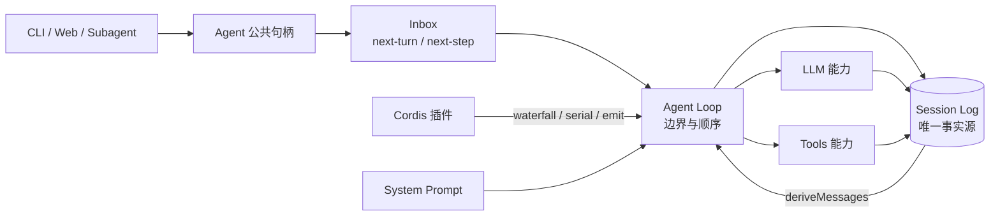
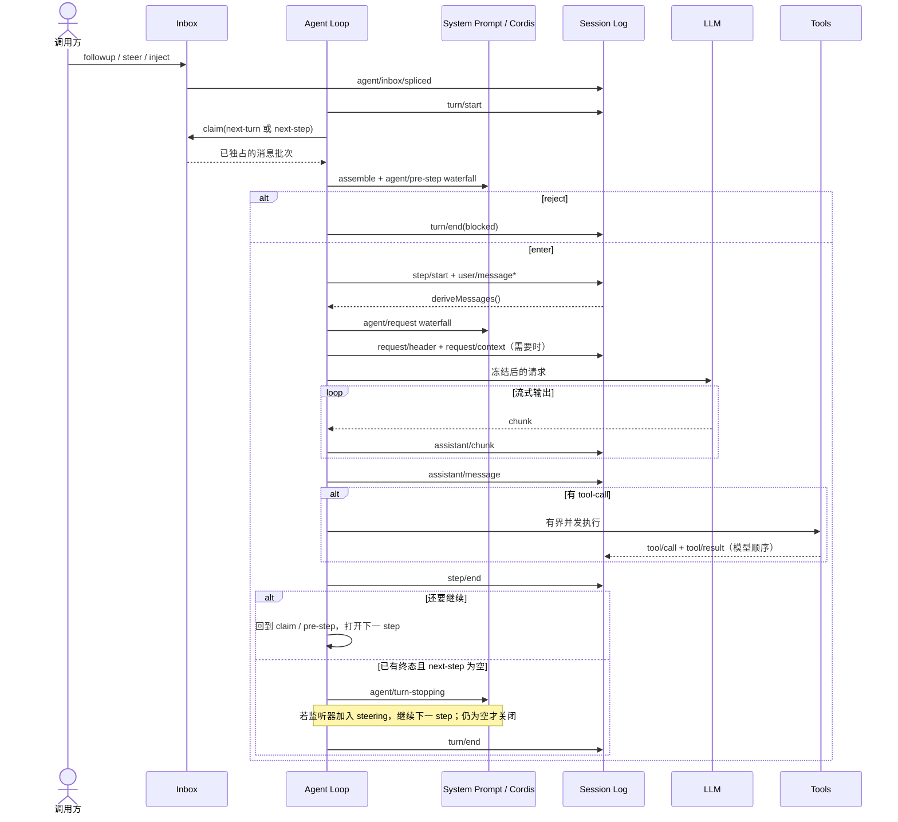

# Agent Loop：一次输入如何变成一条可重放的行动链

> 研究基线：`deepseek-harness@47f943859bef60e4160492346772ded9b24f765a`，2026-08-14。本文只讨论核心执行链；工具 Provider 内部留到后章。

## 先记住四个结论

- Agent Loop 是协调插件的薄执行器。这里的“薄”指行为策略少，不是代码简单。
- Inbox 的消息先被持久化，再在明确的 turn / step 边界转移所有权；插件只能对已经 claim 的整批消息做一次 pre-step 决策。
- 模型请求由 Session Log 派生。当前运行时 invariant、独立重建测试与旧 Agent Note 的校验强度并不相同，后文会分开讲。
- 工具主体可以并发，结果仍按模型给出的顺序提交。取消也要等已启动工作收敛，不能抢先宣告 idle。

上一章讲的是 Agent Scope：每个 Agent 都有自己的能力世界。这一章往里走一步，看一条输入进入这个世界后，怎样被认领、送给模型、变成工具调用，再安全地收尾。

## 1. 它在系统中的位置

依赖方向是刻意的：`dsh-agent` 只声明句柄、Inbox 和事件契约；`dsh-agent-loop` 才提供唯一内置实现。外部包不能反向依赖这个具体 Loop，因此将来可以换执行器而不改公共 Agent 世界。事实依据：`packages/core/agent/src/runtime-types.ts:23-143`、`packages/core/agent-loop/src/index.ts:295-350`、`.agents/notes/implemented/architecture/2026-06-11-microkernel-event-taxonomy.md:13-24`。

### 四组关键数据结构

| 结构 | 它解决什么问题 | 关键点 |
|---|---|---|
| `Phase` | 当前谁拥有执行权 | 只有 `idle / maintenance / running`；活动态带 `AbortController` 和 `wakeRequested` 锁存位。`packages/core/agent-loop/src/agent.ts:38-46` |
| `Inbox` | 输入应该进入哪条边界 | `next-turn` 是普通后续，`next-step` 是 steering/context；每次变更先记 `agent/inbox/spliced`，再改内存投影。`packages/core/agent/src/inbox.ts:57-78,128-192` |
| `PromptAssembly` | 插件怎样共同组 Prompt | sections、contexts、tools、variables 分开收集并经过组装 waterfall；变量插值在之后的 render 阶段发生。`packages/core/system-prompt/src/index.ts:204-255,457-542` |
| `PlannedCall + Slot[]` | 并发工具怎样保持确定性 | Tool 可以乱序完成，但 Slot 按模型给出的索引提交。`packages/core/agent-loop/src/tool-calls.ts:19-38,121-159` |

## 2. 跟着一次输入走完整条链

### 2.1 输入先进入 Inbox，不直接碰历史

通常，`followup()` 写 `next-turn` 并唤醒；`steer()` 写 `next-step` 并唤醒；`inject()` 也写 `next-step`，但不唤醒。若唤醒输入到达时当前 activity 已经 aborted，`send()` 会把它改投 `next-turn`，等旧 activity 收敛后再开 turn。`packages/core/agent-loop/src/agent.ts:113-132,164-193`。

Turn 开始后，Loop 先写 `turn/start`，再调用 `Inbox.claim()`：它会拿走全部 `next-step`，若这是 turn 边界，再拿一条 `next-turn`。Claim 是所有权转移，不是“偷看队列”；被拒绝的批次不会自动塞回去。`packages/core/agent-loop/src/agent.ts:245-275`、`packages/core/agent/src/inbox.ts:63-78`。

这解释了 steering 的精确语义：**它影响尚未 claim 的最近请求，不保证追上已经开始组装的请求。** 必须影响当前请求的插件，应在 `agent/pre-step` 返回改写后的 messages，而不是竞速改 Inbox。这个边界见 `.agents/notes/implemented/architecture/2026-07-31-claimed-pre-step-inbox-lifecycle.md:13-17,27-31`。

### 2.2 每一步重新组 Prompt，但只有最终可见值进入请求

`preStep()` 在每个候选 step 重新组装 System Prompt，渲染动态 runtime context，然后走 `agent/pre-step` waterfall。插件可以保留、替换整批消息，或直接 reject；reject 会得到一个平衡的无 step turn：有 `turn/start/end`，没有 `step/start` 和模型请求。`packages/core/agent-loop/src/agent.ts:225-243,245-275`。

Prompt 组件不是 Loop 里的条件分支。插件通过 `section()`、`context()`、`tools()`、`variable()` 注册贡献；同名的 scoped section、context 和 variable 覆盖全局同名项，tool providers 则共同贡献，最终再经过 `system-prompt/assemble` waterfall。`packages/core/system-prompt/src/index.ts:337-455,457-542`。

动态 context 也不走暗道。`RuntimeContextProjection` 比较上次保留快照，只在内容变化时生成候选 `user/message`；真正提交仍由 pre-step 的最终批次完成。`packages/core/agent-loop/src/runtime-context.ts:24-75`。

### 2.3 请求不是从缓存对话对象里拿，而是从日志重新派生

进入 step 后，Loop 先写 `step/start` 和最终的 `user/message`，随后调用 `session.deriveMessages()`。配置侧把 `agent/request` waterfall 得到的 route/config，与本步 system/tools 合成完整 `EpochHeader`：第一次记 `initial`，恢复后的新 Loop 实例记 `resume`，实例内变化记 `change`；provider/model/contextWindow 变化另记 `request/context`。最后才构造并冻结请求。`packages/core/agent-loop/src/agent.ts:332-349,403-495`。

这里要分开三层。构造路径直接使用日志派生的 messages 和本步 canonical header；header 在首次出现或变化时追加，不变时沿用日志里相等的快照。运行时 invariant 会检查请求冻结状态、live Session 身份、`step/start` 与 `request/header` 是否存在；它把 messages 与当前 Session 的 `deriveMessages()` 比较，并核对 model、system、temperature、maxTokens、stop、tools。它没有新建 Session，也没有逐项核对 provider、reasoningEffort。`packages/core/agent-loop/src/agent.ts:458-493`、`packages/core/agent-loop/src/invariant.ts:19-54`。

独立重建由测试补上：测试截取每次 dispatch 前的日志，创建全新 Session，再比 messages 和更宽的一组 header 字段。`packages/core/agent-loop/tests/request-reconstruction.spec.ts:566-612`。旧 Agent Note 的原则仍有价值，但第 31 行把“新建 Session”写成运行时 invariant 的机制，与本基线源码不符。`.agents/notes/implemented/architecture/2026-07-05-reconstructable-requests.md:17-31`。

所以 `agent/request` 只能改冻结前的调用配置，不能偷偷改 messages。模型能看到的内容必须走可记录渠道。这是限制，也是缓存稳定、恢复和审计成立的前提。

### 2.4 Chunk 是过程证据，assistant/message 才是历史事实

模型每吐一个 chunk，Loop 就同步追加 `assistant/chunk`，同时交给 `BlockAssembler`。流结束后，它把完整 blocks、provider/model、usage 和 chunk 的来源 seq 一次写成 `assistant/message`。`packages/core/agent-loop/src/agent.ts:332-390`。

两层记录用途不同：chunk 支持逐 token 回放和失败诊断；`assistant/message` 才进入 `deriveMessages()`，避免半截流被误当成模型的正式回复。Session 的投影明确只从权威 surface 事件生成历史。`packages/core/session/src/index.ts:700-758`；`.agents/notes/implemented/architecture/2026-06-11-event-sourced-sessions.md:13,17`。

若 `BlockAssembler` 收到 provider 的 in-band `error` / `aborted` finish，且 turn 信号本身没有 abort，`agent/request-error` 可以选择 retry；不接管就抛 `LlmError`。真正的 turn cancellation 会先在 `signal.throwIfAborted()` 处退出，由外层写 `{ kind: 'aborted', reason }`，不会被 retry 插件接管。已经追加的 chunks 仍保留。`packages/core/agent-loop/src/agent.ts:346-370,302-319`。

### 2.5 Tool call 不开新 turn，但会把模型带到下一个 step

完整 assistant message 中没有 tool-call，step 就完成；有 tool-call，Loop 先在当前 step 执行工具并写结果，再关闭这个 step。只要工具没有结束 turn，外层 turn 循环就开启下一个 step，再次从 Session 派生历史并请求模型。这样第二次请求天然看见刚落盘的 `tool/result`。`packages/core/agent-loop/src/agent.ts:367-400`、`packages/core/agent-loop/tests/loop.spec.ts:198-227`。

工具返回的 `additionalContexts` 不会硬插当前请求，而是进入 `next-step`。如果工具声明 `concludesTurn`，当前 step 会给出 completed 结论；但已经进入 Inbox 的 steering/context 仍要先排完，不能被它短路。`packages/core/agent-loop/src/tool-calls.ts:145-159`、`packages/core/agent/src/runtime-types.ts:261-278`。

## 3. 并发工具：执行可以乱序，事实不能乱序

调度器先问 Tools 能力边界 `executionMode()`。只有明确声明 parallel-safe 的调用才能进入并发组；未知、隐藏、无声明、分类器抛错或返回非 `true` 值都按 exclusive 处理。`packages/core/tools/src/index.ts:257-269,1269-1284`。

它使用一个有上限的滚动池：

1. `pre-execute/prepare` 仍按模型顺序进行，只有 dispatch/body 重叠。
2. 池未满就启动下一项；每次启动前重新分类，插件在前面结果提交后改变注册状态，也能让后续调用变成 barrier。
3. 遇到 exclusive，先排空当前并发组，再让它单独运行。
4. 完成结果先放入自己的 `Slot`；`committed` 只跨过连续就绪的索引，因此 `tool/result` 和 `additionalContexts` 始终按模型顺序落地。

实现证据：`packages/core/agent-loop/src/tool-calls.ts:82-100,112-160,162-245`。

为什么不按完成顺序写日志？因为下一次模型请求会读取这串结果。若两次相同执行只因网络快慢不同就得到不同历史，重放、缓存和调试都会漂移。这里用少量等待换确定性，是很值的交易。

取消时不再启动新调用，已启动项必须收敛并按序提交；没启动的工具调用会收到合成的 aborted-before-dispatch `tool/result`，保证每个模型提出的调用都有一对可解释的 call/result。调度器自身失败则等待已派发任务退出，不为缺失结果编造恢复记录。`packages/core/agent-loop/src/tool-calls.ts:112-119,215-245,248-289`。

## 4. Turn / Step 为什么要两层

- **Turn** 是一次用户意图的外壳，也是取消和最终结果的归属边界。
- **Step** 包住一轮模型请求尝试及随后的工具执行；它也可能以请求错误收尾。工具续跑、steering 或 additional context 会在同一 turn 开新 step。
- **同一步内的多次 LLM 请求尝试** 只出现在请求失败后，`agent/request-error` 接管并要求 retry 的情况。

无论成功、blocked、max-tokens、aborted 还是 error，只要 `turn/start` 已成功追加，`finally` 都尝试写 `turn/end`；只要 `step/start` 已成功追加，内层 `finally` 都尝试写 `step/end`。max-tokens 还是 sticky：后续 step 的正常完成不能把它降成 completed。`packages/core/agent-loop/src/agent.ts:245-330`。

这两层边界不是为了画漂亮状态图，而是给 UI、持久化、重试、取消、telemetry 一个共同坐标。

## 5. 取消、错误与清理：停止不是 `abort()` 返回的那一刻

`cancel(cause)` 默认清空两条 Inbox，并对当前 activity 的 controller 发信号；`keepInbox` 可以保留未开始工作。活跃 turn 会在 Prompt、模型、工具和扩展点周围协作检查信号，不会用一个抢先返回的 `Promise.race` 丢下同进程工作。因此 `whenIdle()` 表示 activity 已收敛，不只是状态先改成 idle。`packages/core/agent-loop/src/agent.ts:134-223`、`packages/core/agent/src/runtime-types.ts:78-104`。

一个隐蔽竞态是：取消已经发出，但旧 driver 还没写完 `turn/end`；此时又来一条 waking message。当前实现用 `wakeRequested` 锁存，等旧 driver 的 `finally` 收敛后再启动，并确保 `turn/end N` 先于 `turn/start N+1`。`packages/core/agent-loop/src/agent.ts:164-223`；修复记录：commit `df30c62e2b` 与 `.agents/notes/implemented/bug-fix/2026-08-07-cancel-convergence-wake-latch.md:7-29`。

错误也分两个层次：可恢复的模型失败交给 `agent/request-error`；其他异常发出 `agent/error`，再由 turn 写稳定、可序列化的 failure。通知监听器本身的错误被逐个隔离，不能反过来破坏主流程。`packages/core/agent-loop/src/agent.ts:202-207,302-319`、`packages/core/agent/src/dispatch.ts:98-149`。

Factory teardown 先停止接受新建，再加入所有在途 setup 和 live agent 的清理。单个 agent 的 disposer 会取消 machine、等待 idle、销毁 Agent Scope，最后退出 Agent/Session registry；create/resume 中途失败也复用这一个 memoized disposer。`packages/core/agent-loop/src/index.ts:39-90,453-578`。代码不少，但它处理的是所有权与收敛，不替 Agent 决定行为策略。

## 6. 哪些事情 Loop 故意不做

| 行为 | 扩展点 / 所属能力 | Loop 只做什么 |
|---|---|---|
| 改写或拒绝本步消息 | `agent/pre-step` waterfall | 原子 claim，落实最终批次 |
| 决定 Prompt、工具可见性 | `SystemPrompt` 注册项 + `system-prompt/assemble` | 每步组装和渲染 |
| 选择模型参数 | `agent/request` + LLM `prepareCall` | 记录完整 header，冻结请求 |
| 模型失败重试 | `agent/request-error` | 循环或转成终态 error |
| 权限、沙箱、工具实现 | Tools pipeline | 调度、排序、记 call/result |
| 关闭 turn 前再行动 | `agent/turn-stopping` serial | 重新检查 Inbox，再决定关闭 |
| 持久化 | Session persistence + checkpoint policy | 只同步 append；Loop 本体不调用 `flush()` |

`flush` 的所有权尤其容易写错。当前 `session-checkpoint-policy` 在 pre-step、模型真正 dispatch 前、顶层工具 body 前调用 `ctx.sessions.flush()`；Loop 只追加边界和消息。`.agents/notes/implemented/architecture/2026-06-11-event-sourced-sessions.md:15` 仍写着“每个 turn 末由 Loop 触发 flush”，那是早期实现，不是本基线行为。现行代码见 `packages/session/session-checkpoint-policy/src/index.ts:29-37,63-82`。

这是 Cordis 微内核设计很具体的一面：新行为优先放在插件扩展点，Loop 保留顺序、所有权和资源收敛。

## 7. 这版设计是怎样演进来的

| 时间 / 提交 | 发生了什么 | 证据等级与说明 |
|---|---|---|
| 06-11 `43f4258277` | 第一版 streaming-first Loop：queued/steering FIFO、step 级取消、chunk 日志、工具往返 | 【合理推断】先打通可观测、可插拔的 MVP 主链 |
| 07-06 `c0808d5126` | 写下“每次 LLM 请求都能从日志重建”的治理原则 | 【已证实】解决模型可见内容、缓存与日志可能分叉的问题 |
| 07-13 `7ea1bf119f` | parallel-safe 工具开始并发 | 【已证实】独立调用重叠执行，提交顺序不变 |
| 07-16 `3b1d1bfa12` | exclusive 与 parallel 统一到一个滚动池，并加入并发上限 | 【已证实】去掉双调度路径，用 barrier 表达排他 |
| 07-17 `62f6251bf9` | 未启动调用在真正启动前重新分类 | 【已证实】前序提交后的注册变化可以改变后续安全分类 |
| 07-30 `f2e20c1ef0` | `agent.ts` 大幅净删状态与分支 | 【合理推断】结合后续提交看，方向是让 Inbox claim 与日志边界承担更多状态 |
| 07-31 `fcc2b5e282` | 改成 claim 后只做一次 pre-step 决策 | 【已证实】消除 prepare/admit/step 多入口与所有权歧义 |
| 08-04 `d4fa26023d` | `turn/start` 前移到 pre-step 之前 | 【已证实】即使拒绝或失败，claim 也有明确 turn 归属 |
| 08-07 `df30c62e2b` | 修复取消收敛窗口丢 wake，加入 latch | 【已证实】新工作不再搁置，也不会和旧 driver 重叠 |
| 08-10 `fdf9bddbf8` | 并发上限成为可更新设置 | 【已证实】下一组读取新上限，运行中的组不变 |

我看到的主线是持续减少“半拥有”的状态。消息归 Inbox claim，模型可见内容归日志，并发结果归有序 Slot；后来的修复大多在补这些交界处的竞态。

### 取消语义要分三层证据

当前 live 写入会持久化 `{ kind: 'aborted', reason: AgentCancelCause }`；`user`、`parent`、`hook` 和 `disposed` 都放在嵌套的 `reason` 中。依据是 `packages/core/session/src/types.ts:142-158` 与 `packages/core/agent-loop/src/agent.ts:302-305`。

旧决策记录 `.agents/notes/implemented/architecture/2026-07-16-explicit-turn-cancellation.md:15-17` 描述的是当时的 coarse `{ kind: 'aborted' }`，不能拿来断言当前格式。导入兼容层处理的又是第三件事：旧记录没有 caller 时映射成 `{ kind: 'aborted', reason: { kind: 'legacy' } }`，旧 `{ kind: 'disposed' }` 则映射成嵌套的 disposed cause。`packages/session/session-persistence/src/coordinator.ts:385-415`。

`legacy` 只属于旧磁盘数据的读兼容，不是 live `AgentCancelCause`。仓库没有说明旧 Note 的冲突是刻意保留的历史上下文，还是漏改。

## 8. 事实、推断与未知

**已确认事实**

- 模型可见消息由 Session Log 派生；运行时 invariant 对 live projection 和选定 header 字段做检查，fresh-Session 重建由测试覆盖。
- Tool body 可以并发，但 call/result/context 按模型顺序提交。
- 插件拥有策略，Loop 拥有顺序、边界、取消与资源收敛。
- Loop 本体不拥有 durability flush；语义检查点是独立插件。

**合理推断**

- 团队追求的“薄 Loop”是行为策略薄，不是实现体积薄。工厂所有权、竞态和确定性调度仍然复杂。
- 07-30 到 08-04 的连续重构，目标是在减少中间状态的同时，把每次所有权转移都锚定到 durable boundary。

**仍然未知**

- 提交记录能证明改了什么，不能证明作者当时全部心理过程；表格中的动机只使用 commit message 或 Agent Note 能支持的部分。
- cancellation Note 的旧段落是遗漏、保留的历史背景，还是待改写内容，仓库里没有明确说明。

## 9. 给独立开发者的可复用原则

1. 把 Loop 写成“机制裁判”，不要让它长成业务策略仓库。
2. 所有会改变下次模型输入的东西，先成为 durable fact，再发请求。
3. 并发优化只放宽执行时间，不放宽提交顺序。
4. 取消必须等待工作收敛；假 idle 比慢一点更危险。
5. 插件入口可以很多，但每个边界只能有一个权威所有者。

至此还有一个绕不过去的问题：既然 Inbox、Prompt、模型输出、工具结果甚至取消原因最终都要靠日志解释，**Session Log 为什么必须成为唯一事实源，而不只是旁路审计记录？** 下一章应从这里展开。

## 读到这里，你应该明白什么

- 一条输入先持久化到 Inbox，进入 turn 后才被 claim；pre-step 是当前请求的消息改写边界。
- `turn/start → claim → pre-step → step/start → user/message → request` 的顺序决定了失败、取消和重放能否解释。
- 工具 body 的完成顺序不等于日志提交顺序；exclusive call 会等待并发组排空。
- `abort()` 只发出停止信号。`turn/end`、已启动工具和旧 driver 都收敛后，Agent 才真正 idle。

## 审查记录

本轮对抗性审查抽查了 18 条结论，覆盖 Inbox 的 claim/steer/inject、pre-step 所有权、turn/step 顺序、request/header、消息重建、流式事件、工具滚动池与 barrier、续步、取消、错误、teardown 和 flush。修正事实问题 8 处：aborted activity 后的唤醒会改投 next-turn；Prompt 插值发生在 assembly waterfall 之后；运行时 invariant 没有新建 Session，也未核对全部 header 字段；turn cancellation 不进入 request-error retry；Step 也可能以错误收尾；turn-stopping 是条件路径；flush 不属于 Loop；当前取消原因、旧 Note 和 legacy 导入映射是三套不同事实。历史动机有 2 处降为【合理推断】。文风上保留“薄但不简单”的判断，删掉了几处笼统的宣传式结论。

## 阅读覆盖率

核心范围包括 Agent Loop、Agent 公共契约与 System Prompt 的选定生产源码。本轮在快照 `47f9438` 上复核了每个文件的 `wc -l` 和 3,884 行合计；表中的 100% 是初稿申报的全文阅读范围，不代表本轮重新逐行审阅了全部文件。测试、文档、Agent Notes 和定点阅读不混入分母。

| 核心文件 | 初稿申报已读 / 总行 | 覆盖率 |
|---|---:|---:|
| `packages/core/agent-loop/src/agent.ts` | 496 / 496 | 100% |
| `packages/core/agent-loop/src/constants.ts` | 6 / 6 | 100% |
| `packages/core/agent-loop/src/index.ts` | 713 / 713 | 100% |
| `packages/core/agent-loop/src/invariant.ts` | 63 / 63 | 100% |
| `packages/core/agent-loop/src/runtime-context.ts` | 76 / 76 | 100% |
| `packages/core/agent-loop/src/tool-calls.ts` | 289 / 289 | 100% |
| `packages/core/agent/src/consumed-work.ts` | 108 / 108 | 100% |
| `packages/core/agent/src/dispatch.ts` | 176 / 176 | 100% |
| `packages/core/agent/src/inbox.ts` | 220 / 220 | 100% |
| `packages/core/agent/src/index.ts` | 706 / 706 | 100% |
| `packages/core/agent/src/invariant.ts` | 32 / 32 | 100% |
| `packages/core/agent/src/model-selection.ts` | 75 / 75 | 100% |
| `packages/core/agent/src/runtime-types.ts` | 292 / 292 | 100% |
| `packages/core/agent/src/types.ts` | 27 / 27 | 100% |
| `packages/core/system-prompt/src/index.ts` | 545 / 545 | 100% |
| `packages/core/system-prompt/src/invariant.ts` | 60 / 60 | 100% |
| **合计** | **3884 / 3884** | **100%** |

关联定点阅读：`packages/core/tools/src/index.ts` 的执行模式、`packages/core/session/src/index.ts` 的消息派生、`packages/session/session-checkpoint-policy/src/index.ts` 的 flush 边界，以及 `packages/session/session-persistence/src/coordinator.ts` 的 legacy 取消映射；另核对 Agent Loop 的 loop/cancel/tool-order/request-reconstruction 测试和相关 Agent Notes。

## Humanizer-zh 自检

直接性 9/10，节奏 9/10，信任度 9/10，真实性 9/10，精炼度 9/10，总分 45/50。保留第一人称的架构判断，但把运行时事实、历史决策和作者意图分别标记；正文没有把“薄”偷换成“简单”。
