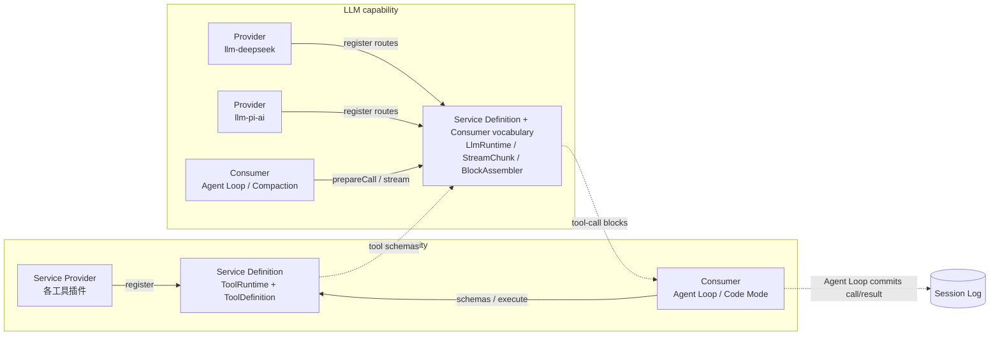
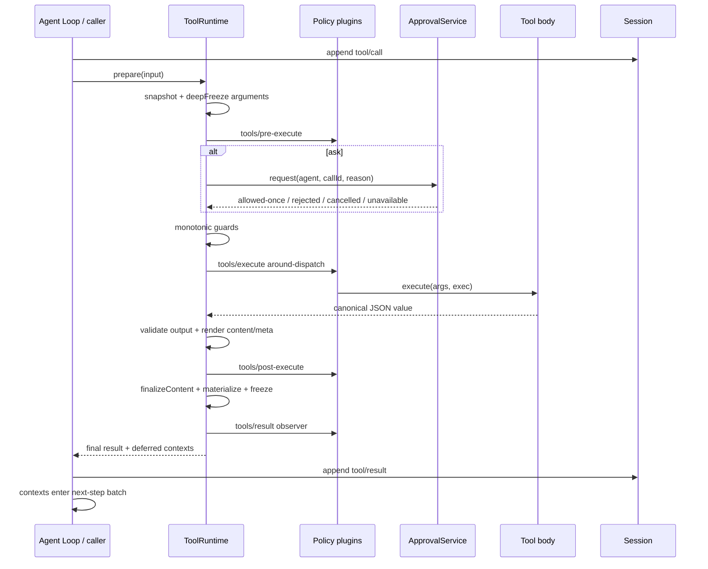

# Tool / LLM Capability：把“会做事”和“会思考”接到稳定边界上

> 研究基线：`deepseek-harness@47f943859bef60e4160492346772ded9b24f765a`，2026-08-14。本文以当前代码为准；Agent Note 用来解释设计来路，不替代实现事实。

上一章的 Session Log 解释了两件事：模型到底看见了什么，系统又把什么当成持久事实。现在还差中间一层：模型和工具来自哪里？DeepSeek API、第三方模型库、本地 bash 为什么可以被替换，却不需要把 Agent Loop 改成一团 provider 分支？

先给结论：**Harness 把能力拆成稳定协议、可替换实现和调用方；Loop 负责调度，不内置具体模型或工具。** Tools 把一次调用约束成可审计的执行流水线，LLM 把不同供应商翻译成同一种流协议。两边冻结的东西并不相同：ToolRuntime 固定调用身份、参数和部分回调，LLM Runtime 固定 provider route 的 owner 与请求默认值；Provider 再各自捕获发请求所需的配置。不能把这些局部保证概括成“整次调用的所有配置都不会变化”。

## 1. 两条能力边界，而不是两个工具箱

这里的“capability seam”不是一个 TypeScript 接口，而是完整的三角色组合：**Service Definition / Service Provider / Consumer**。角色分包的判断标准也不是形式整齐，而是变化速度是否独立。Shell 三者分得很开；LLM 的 Service Definition 和 Consumer vocabulary 都在 `dsh-llm`，因为它们本来就是同一套 provider-neutral 协议。设计依据见 `.agents/notes/implemented/architecture/2026-06-13-capability-seams.md:13-29`。

底层机制来自 Cordis：`Service` 把能力挂到 `ctx.<key>`，`inject` 声明依赖，`ctx.effect()` 让注册随插件生命周期撤销，waterfall 提供可排序的改写链。Tools 和 LLM 在这套机制上各自增加了领域约束，而不是另造一个依赖注入框架。`docs/architecture.md:11-13,45-52`。

### 核心数据结构

| 结构 | 它拥有的决定权 | 不拥有的决定权 |
|---|---|---|
| `ToolDefinition` | 参数 schema、规范输出、执行函数、可选并发声明和展示投影 | Session 如何提交、是否批准、并发池大小 |
| `ToolExecution` / `ToolRunContext` | 稳定 call/root/token 身份、冻结参数、取消信号、延后 context | `deferContext()` 只把候选结果交回 Loop；类型仍暴露 `exec.agent`，并未物理禁止工具访问 Session |
| `ToolExecutionResult` | 成功时的执行期 JSON `value`、模型可见 `content`、展示 `meta` | `value` 不自动成为持久格式 |
| `AdapterRegistration` | provider route 的唯一 owner、adapter、注册时捕获的 retry policy | model catalog 不是路由白名单 |
| `GenerateOptions` / `StreamChunk` | 一次模型请求和 provider-neutral 流协议 | 公共字段不暴露某家 SDK；终止 chunk 可带 adapter-private `replayState` |
| `BlockAssembler` | 按 block index 拼 reasoning、text、tool call，收 usage/finish/replay state | 不做 provider 选择，也不写 Session |

源码：`packages/core/tools/src/index.ts:211-288,304-421`、`packages/llm/llm/src/index.ts:284-413,941-945`、`packages/llm/llm/src/types.ts:283-325`、`packages/llm/llm/src/assembler.ts:15-41`。

## 2. ToolRuntime：schema 和执行策略分开走

### 2.1 注册时保留完整定义，发给模型时只投影白名单

工具插件通过 `ctx.tools.register()` 注册 `ToolDefinition`。注册会检查输出声明及其 schema、超时值和保留名称，并把 disposer 绑定到当前 Cordis effect。它不会替 raw `ToolDefinition` 校验参数 schema；参数作者约束由 `defineTool()` 的编译器负责，`schemas()` 只要求最终参数能无损复制。全局工具和 Agent Scope 工具分层保存；同名 scoped 工具可以覆盖继承项，restriction 只过滤继承来的能力。`packages/core/tools/src/index.ts:1031-1061,1152-1192,1228-1267`。

模型不会拿到整个定义。`schemas()` 重新构造 `{name, description, parameters}`，而不是删掉几个敏感字段；`execute`、`timeoutMs`、`isConcurrencySafe` 和 UI presenter 都不会漏进请求。这个 allowlist 比“复制对象再 omit”更抗未来字段增长。`packages/core/tools/src/index.ts:1228-1267`。

第一方工具常用 `defineTool()`：作者写一份简化 DSL，它编译成受支持的 JSON Schema，同时给 TypeScript 推断参数和输出；真正执行前仍做运行时校验。展示函数面对旧日志时采用软校验，失败就回退通用卡片；并发分类遇到非法参数则返回 false。类型推断改善了开发体验，但模型参数仍要经过运行时校验。`packages/core/tools/src/schema.ts:432-480,482-617`。

### 2.2 执行 waterfall：能改什么，在哪一层改

默认 `execute()` 依次跑完这条链；Agent Loop 的并发调度使用 symbol-keyed 内部视图，把它拆成 `prepare / dispatch / finalize / finish`。这个内部接口不是插件扩展点，目的是只让中间 body 重叠，见 `packages/core/tools/src/index.ts:426-466,1328-1361`。

各阶段边界很具体：

- `tools/pre-execute` 返回 `allow / deny / ask`。`ask` 才调用可选的 `ctx.approval`；只有 `allowed-once` 放行。没有 ApprovalService、没有 Agent、用户拒绝或没有可用 channel 都会明确拒绝，不会静默继续。`packages/core/tools/src/index.ts:1453-1507,1678-1729`。
- `guard()` 在 pre waterfall 之后运行，只能返回拒绝理由，不能替其他 guard 强行 allow。这是给不可被插件顺序冲掉的单调底线。`packages/core/tools/src/index.ts:1100-1127`。
- `tools/execute` 是 around-dispatch，可包住 body、替换临时 signal 或加入 timeout，但 registry 会把 caller signal 融合回来。已经启动的同进程工具不会被 `Promise.race` 遗弃，必须协作停止并收敛。`packages/core/tools/src/index.ts:1527-1599`；取消决策见 `.agents/notes/implemented/architecture/2026-07-19-cooperative-tool-cancellation.md:23-43`。
- `tools/post-execute` 可 block；accept 时只能替换 `value` 或 `content` 之一。换 `value` 会重新验证并重算展示；只换 `content` 不会隐藏 Code Mode 能拿到的结构值，所以它不是保密机制。`packages/core/tools/src/index.ts:1731-1781`。
- 工具自己的 `finalizeContent` 最后修整所有结果，包括绕过 post 的失败；`tools/result` 只观察已经物化、冻结的权威结果。完整顺序也被单独写进 `docs/tool-execution-pipeline.md:6-25`。

### 2.3 输出为何分成 `value` 和 `content`

工具 body 只返回规范 JSON value。Registry 做 lossless snapshot、按 `output.schema` 验证、冻结，再调用纯函数 `render()` 生成模型文本；顶层调用还可生成可重放的 `meta`。`packages/core/tools/src/index.ts:1792-1844`。

这解决了两类消费者的冲突：Native function calling 需要适合模型阅读的 `content`，Code Mode 需要无需解析文案的结构值。工具作者要同时设计领域结果和模型投影，好处是只保留一份作者定义的结果，`content` 由它计算而来。演进理由见 `.agents/notes/implemented/architecture/2026-07-20-canonical-tool-output-contract.md:7-37`。

与 Session 的边界尤其重要：

- Agent Loop 在执行前写 `tool/call`，完成后只把 `content`、可选错误 `{name, code}` 和可选 `meta` 写进 `tool/result`。
- 执行期 `value` 不持久化；重放能恢复模型/UI 所见，不能恢复程序化中间值。
- `additionalContexts` 要等对应 `tool/result` 提交后，才按调用顺序进入下一 step。

代码证据：`packages/core/agent-loop/src/tool-calls.ts:164-208,261-289`；设计取舍：`.agents/notes/implemented/architecture/2026-07-20-canonical-tool-output-contract.md:35-37,67-79`。因此 ToolRuntime 本身不提交 `tool/call` / `tool/result`，Loop 拥有这对事件的提交顺序。这个结论只限于调用配对；工具仍可记录自己领域内的 Session 事件，`exec.agent` 也没有被做成不可达对象。

## 3. 为什么 body 能并发，提交仍保持顺序

并发决策不是工具名白名单。工具可声明同步纯函数 `isConcurrencySafe(args)`；只有严格返回 `true` 才能加入并发组。缺失、异常、未知或隐藏工具一律 exclusive；通过 `defineTool()` 声明的工具还会把非法参数判为 exclusive。raw 定义是否校验参数，仍由它自己的 classifier 负责。`packages/core/tools/src/index.ts:257-269,1269-1285`、`packages/core/tools/src/schema.ts:610-615`。

真正的调度在跨模块的 `dsh-agent-loop`，不在 ToolRuntime：

1. 模型顺序扫描调用。连续 parallel 调用进入有界滚动池，exclusive 单独成组并形成前后 barrier。
2. `tool/call`、pre-execute 与 guard 按模型顺序进行；只有 around-dispatch 与 body 会重叠。
3. 完成结果先落到各自 `Slot`。commit cursor 只跨过连续就绪项，按模型顺序执行 post、写 `tool/result`、接收 contexts。
4. 每次补充池前重新读取 classifier；注册热替换可以把尚未开始的调用变成新 barrier。
5. abort 后停止补充、等待已开始调用收敛，并给未开始项补平衡的取消结果；调度器自身崩溃则等待收敛，但不伪造工具结果。

实现集中在 `packages/core/agent-loop/src/tool-calls.ts:82-100,121-245`。快结果可能被前面的慢结果暂时挡住，这是用一点尾延迟换确定历史。更简单的实现通常选择全部串行，或是谁先完成就先提交；前者浪费独立 I/O，后者会让同一次模型输出因网络抖动得到不同历史。Harness 只放宽执行窗口，政策与结果仍按模型顺序处理。

`bash` 当前没有并发声明，所以默认就是排他 barrier，不是遗漏。仓库明确把写文件、bash、用户交互等保守留在 exclusive；只有能够承诺“不改父状态且共享依赖可重入”的调用才 opt in。`.agents/notes/implemented/feature/2026-07-10-parallel-tool-call-execution.md:53-65`。

## 4. 一个完整 seam：bash 从合同到模型工具

Shell 是三角色拆分最清楚的样本。

| 角色 | 包与关键位置 | 责任 |
|---|---|---|
| Service Definition | `packages/shell/shell/src/index.ts:1-101`、`packages/shell/shell/src/types.ts:32-183` | 声明 `ctx.shell`、Request→Spec、前台结果与后台 process handle 的语义 |
| Service Provider | `packages/shell/bash-local/src/index.ts:95-330` | 用 `ctx.subprocess` 实现 `bash -c`、默认 cwd/timeout、输出上限、进程组取消和后台读取 |
| Consumer | `packages/shell/tool-bash/src/index.ts:190-393` | 注册模型可见 `bash` schema，解析 session workdir，收集 DSH 环境，接 approval/sandbox/jobs，再调用 `ctx.shell` |

调用方向是 `tool-bash → ctx.shell → bash-local → ctx.subprocess`。Consumer 只 import Definition 类型，不认识 `LocalBashExecutor`；因此可以把 provider 换成 sandboxed bash，而不改模型看到的 `bash` 参数。反过来，展示文案、`run_in_background` 和 job id 属于 Consumer，不污染进程执行合同。

这个 seam 也展示了策略应放哪里：本地 provider 明说不负责 execution policy；通用 `tools/pre-execute` 可做部署级授权，sandboxing provider 执行文件隔离，`tool-bash` 只在一次明确提权请求上调用共享 approval helper。`packages/shell/bash-local/src/index.ts:1-9`、`packages/shell/tool-bash/src/index.ts:202-233,330-389`。

失败分层也没有混在一起：非零退出、timeout kill 和 abort kill 是 `ShellRunResult`，不是基础设施 reject；tool consumer 再把前台 abort 变成稳定的 `TOOL_ABORTED`。后台进程移交给 `ctx.jobs` 后，取消所有权也随之移交，不再挂在原 tool-call signal 上。`packages/shell/shell/src/index.ts:52-63`、`packages/shell/tool-bash/src/index.ts:349-389`。

## 5. LLM Runtime：按 provider route 选 owner，再把流变成统一语言

### 5.1 Registry 路由的是 provider，不是 model

`registerAdapter(providers, adapter)` 先验证整组 route，再一次性提交；任何 route 已有 owner，整组以 `DUPLICATE_ADAPTER` 失败。registration handle 的 `replace()` 同样先验证后原子交换，没有“旧路由已删、新路由还没加”的空窗。`packages/llm/llm/src/index.ts:330-413`。

model catalog 只是给 Web、ACP 等 selector 的建议，不是请求白名单。请求先用 `provider` 找 adapter，再由 adapter 决定一个确切 model 是否接受：官方 DeepSeek adapter 会把未列入 catalog 的 model id 原样透传；pi-ai adapter 则要求 route 的 `Models` collection 里存在它。`packages/llm/llm/src/index.ts:610-718`、`packages/llm/llm-deepseek/src/adapter.ts:171-212`、`packages/llm/llm-pi-ai/src/adapter.ts:208-273`。

Loop 不应分别调用“查能力”和“发请求”，否则 HMR 可能在两个 await 之间换 owner。`prepareCall()` 捕获当前 registration，解析并冻结 reasoning、maxTokens 和 context，返回只能调用一次的 `stream()`；调用方若在 dispatch 前改写 provider/model 等 call config，会直接报错。它固定的是 Registry owner 和解析后的 call config，不是 Provider 包内部的全部 settings。`packages/llm/llm/src/index.ts:730-814`。

### 5.2 adapter → chunk → block

Adapter 不返回 SDK message，而是发 `StreamChunk`：block-start、text/reasoning/tool-call delta、block-end、usage、finish。block index 允许不同内容流交错；tool arguments 从 adapter 输出到 Session 保持 JSON 字符串。usage 必须先于 finish，finish 后不能再有 chunk，这是 adapter 的协议义务；`BlockAssembler` 本身没有替错误 adapter 验证整条时序。`packages/llm/llm/src/types.ts:283-303`。

`llm/stream` waterfall 可以包住整个流。最终 adapter 边界把 adapter 选择、构造 iterator 和迭代时的错误统一成终止 `finish {error|aborted}`；middleware、下游 consumer 和 cleanup 的错误仍抛出，避免把插件 bug 冒充 provider 失败。`packages/llm/llm/src/index.ts:838-938`。

`BlockAssembler` 按 index 累积 delta，也接受只有 delta、没有 start/end 的协议；一个 index 首次 `block-end` 后即封口，后来的脏 delta 被忽略。finish 为 `max-tokens` 时，它会丢掉本次消息里的全部 tool-call，包括已经收到 `block-end` 的调用。这个保守规则避免模型在被截断的回复里触发工具。`packages/llm/llm/src/assembler.ts:25-38,47-117,128-163`。

这和上一章的 Session 规则接在一起：Loop 逐条记录 raw chunk，再把 assembler 产出的 blocks 写进 `assistant/message`。后续历史从这条 message 派生，不从零散 chunk 直接拼。`packages/core/agent-loop/src/agent.ts:332-400`。

## 6. 两个内部实现不同的 Provider，如何共存

| 维度 | `llm-deepseek` | `llm-pi-ai` |
|---|---|---|
| 内部机制 | 直接 `fetch` `/chat/completions`，`eventsource-parser` 解 SSE，仓库内 serialize/translate | `@earendil-works/pi-ai` 的 `Models.streamSimple()`，按模型 descriptor 懒加载协议/SDK |
| 路由/模型 | 固定拥有 `deepseek-official`；catalog 建议性，未知 model 可透传 | 一个插件可拥有多 route；每个 model 必须能从该 route 的配置/catalog 解析 |
| 能力差异 | text-only；支持 stop；原生 `off/high/max` 与 DeepSeek thinking 序列化 | 可按 model 声明 image/reasoning；公共 API 不支持 stop，明确报 `UNSUPPORTED_OPTION` |
| 错误来源 | HTTP status、header、SSE/transport throw，可保留 request id 与 retry-after | provider 失败可表现为流内 error event；preflight、timeout 等仍会 throw，上游丢失 cause 时只能按错误文本分类 |
| Token | `inputTokens` 从 `prompt_tokens` 中减掉 cache hit；`outputTokens` 保留 completion 总数，wire 提供时另记 `reasoningTokens` | 映射 input/output/cache read/write；pi-ai 已把 reasoning 算进 output，没有独立 reasoning 计数 |
| Replay | provider-neutral blocks；按 DeepSeek 规则回传必要 reasoning | 保存版本化 replay state，恢复 response id、签名等 provider metadata |

源码：`packages/llm/llm-deepseek/src/adapter.ts:117-149,214-345`、`packages/llm/llm-deepseek/src/serialize.ts:63-187`、`packages/llm/llm-deepseek/src/translate.ts:45-61,86-185`；`packages/llm/llm-pi-ai/src/adapter.ts:276-357`、`packages/llm/llm-pi-ai/src/provider.ts:29-51,137-192`、`packages/llm/llm-pi-ai/src/stream.ts:18-61,64-208`。

“共存”不是同一 route 上做 fallback。两者可以同时挂载，但只能拥有不同 provider route；同一路由里谁后注册，谁就因 `DUPLICATE_ADAPTER` 失败。官方 base composition 同时挂载两个插件：`llm-pi-ai` 默认没有 profile，因此不注册 route；`llm-deepseek` 默认拥有 `deepseek-official`，默认 Agent 也选择这个 route。用户给 pi-ai 增加其他 route 后，两套 adapter 才同时服务请求；若后来让 pi-ai 也声明 `deepseek-official`，这次更新会被拒绝，pi-ai 原有 route 保持不变。`packages/bundle/base/cordis.patch.yml:61-96,446-451`、`packages/llm/llm-pi-ai/src/index.ts:247-310`。

为什么用两个 provider 验证同一 seam？mock 往往只重复核心协议的假设。直接 fetch 的迭代器会 throw，pi-ai 主要把失败放进 terminal event；前者拿到原始 argument fragments，后者会在 toolcall_end 给出 parsed object；两者的 token 与 replay 语义也不同。共同跑通后，core 才有证据要求 usage-before-finish、raw JSON arguments 和两种错误路径。这不是性能或功能优劣比较：原生 adapter 专门服务 DeepSeek chat-completions，pi-ai adapter 的目标是覆盖多 provider。设计记录：`.agents/notes/implemented/architecture/2026-06-13-twin-llm-adapters.md:7-27`。

### 配置冻结与 provider coupling

两个 Provider 都按请求读取配置，但“请求”要拆开看。`resolveModel()` 和 `stream()` 是两次 adapter 操作；每次操作各自取完整 snapshot。DeepSeek 在 `stream()` 开始时把 endpoint、credential reference 和默认值放进一个 `ResolvedDeepSeekOptions`，再从同一份 snapshot 解析 key，因此进行中的 stream 不会把新 key 配到旧 URL。pi-ai 用 profiles identity 缓存 immutable `Models` collection；配置变化时新建 collection，因为 `streamSimple()` 到首次消费时才懒解析 provider。`packages/llm/llm-deepseek/src/index.ts:109-115,200-246`、`packages/llm/llm-deepseek/src/adapter.ts:214-235`、`packages/llm/llm-pi-ai/src/adapter.ts:1-19,193-205,276-323`。

这里有一道容易漏掉的缝：Core 的 `prepareCall()` 会先调用 `resolveModel()`，Provider 的 `stream()` 稍后才再次取内部 settings。源码保证 registration owner 和 call config 不变，也保证 stream 一旦开始就使用一代连接配置；它没有把 Provider settings snapshot 从 `resolveModel()` 一路传给 `stream()`。两步之间若恰好发生 settings 更新，传输层可能读到新一代 Provider 配置。这是从当前调用链得到的边界判断，仓库没有把它列为跨操作快照承诺。

route set、provider metadata 与 retry policy 在注册时捕获，相关设置变化要调用 registration `replace()`；DeepSeek 的 route 和显示名固定，因此它只需为 retry policy 触发 replace。其余 request facts 在 adapter 下次读取配置时更新。pi-ai 的 profile 还会在写入 settings 时做 serviceability 校验，无法实现的 protocol/model 不会先落盘再悄悄禁用整组 route。`packages/llm/llm-deepseek/src/index.ts:248-275`、`packages/llm/llm-pi-ai/src/index.ts:89-105,247-275`、`packages/llm/llm-pi-ai/src/config.ts:254-272,293-372`。

耦合仍然存在。原生 adapter 明确绑定 DeepSeek chat-completions 语义；pi-ai adapter 依赖该库的 catalog、事件与 auth 行为，甚至因为上游把 cause 压成字符串而不得不做文本分类。这条边界只是把差异留在 Provider 包里，不会让差异消失。

### 模型体验、Token 与 KV Cache

两种 adapter 都不额外注入 prompt 文案。模型看到 core 组好的 system/history/tools 与 provider 支持的调用参数。DeepSeek 只在带 tool call 的历史 assistant turn 回传 reasoning，以满足 API 且避免无关 reasoning 反复占 token；pi-ai 可用 replay state 恢复原生 provider metadata。`packages/llm/llm-deepseek/README.md:79-107`、`packages/llm/llm-pi-ai/README.md:160-188`。

【合理推断】按两份 Provider README 描述的前缀缓存机制，不变的请求前缀才可能复用。换 provider/model，或修改 system prompt、tool schema、前缀历史，可能从首个差异处失去复用；追加已记录回复通常保留更早的共同前缀。usage 与未记录 transport metadata 不进入下一次请求。仓库没有生产命中率数据，也不能据此保证某家 Provider 一定命中缓存。

## 7. 这版设计是怎样演进来的

| 时间 / 提交 | 变化 | 仓库能确认的动机 |
|---|---|---|
| 06-13 `39b3db4b9c` | 写下 capability 三角色，并同时要求两种真实 LLM adapter | 防止 provider、模型 schema 和消费 API 同步改动；用异构实现验证中立协议 |
| 07-13 `7ea1bf119f` | 增加 per-call 并发安全声明与 ordered scheduler | 缩短独立 I/O 延迟，同时保留 Session 顺序 |
| 07-14 `e547980d77` | adapter registry 从 model key 改为 provider route | 支持一个 provider 的开放 model catalog，也允许同名 model 出现在不同 provider |
| 07-21 `66c36e7325` | 工具改成 canonical typed output + render | 让 Code Mode 获得结构值，Native/重放继续使用稳定内容 |
| 07-29 `f05ab3f945` + `c0426142c5` | DeepSeek 与 pi-ai 分别改成 request-level 配置解析 | 改 key/endpoint 不需重启；缺 key 变成可行动的请求期错误 |
| 07-30 `54f95d7669` | whole-snapshot request、credential fail-loud、route atomic replace | 消除跨代 URL/key 混用和 dispose→register 空窗 |
| 08-04 `4c80cab108` | pi-ai 每次 operation 捕获 immutable snapshot | 补上 SDK 懒解析造成的中途换 provider 风险 |

提交历史只能说明改了什么；“作者当时完整的心路历程”无法从 Git 还原。上表的动机只使用 commit message 与已实现 Agent Note 能直接支持的部分。

## 8. 文档怎样帮助读这套设计

这个仓库的文档不是一份巨型说明书，而是四层证据：

1. `docs/architecture.md` 给全局地图和“新行为放哪里”。
2. `docs/subsystems/tools.md`、`docs/subsystems/llm-streaming.md`、`docs/subsystems/shell.md` 给当前数据合同，适合查结构。
3. `docs/tool-execution-pipeline.md` 把跨包时序单独拉平，适合排查一次调用卡在哪层。
4. `.agents/notes/implemented/**` 记录问题、决策、备选和后果，适合回答“为什么不是另一种设计”。

阅读顺序应当是代码确认当前事实，Subsystem 文档建立词汇，Agent Note 补历史理由。Note 不是永远同步的规范；若三者冲突，以当前代码和测试为准。

## 9. 事实、推断与未知

**已确认事实**

- 工具与模型都通过 Registry/Service 接入，Agent Loop 没有按工具名或 provider 写主流程分支。
- Tool body 可并发，但 pre/post、`tool/result` 和 contexts 保持模型顺序；调度权属于 Agent Loop，执行规范属于 ToolRuntime。
- 同一 provider route 只能有一个 adapter owner；原生 DeepSeek 与 pi-ai 是 composition 层的替代或分路实现，不是隐式 fallback。
- Tool canonical value 是执行期 API，Session 持久化的是模型/UI 投影。
- Tool 类型没有禁止访问 `exec.agent.session`；在模型直调路径中，Loop 负责 `tool/call` 与 `tool/result` 的配对提交，不能把它写成“所有 Session 写入都归 Loop”。

**合理推断**

- 这套架构没有追求最少代码。我的判断是，它更在意让重放、策略插件和 provider 差异有明确归属；对热更新的隔离是分阶段的，不是整次调用的一张全局快照。
- “先做两个异构 Provider”是一种架构测试：它增加维护成本，却比单实现后补抽象更早暴露协议泄漏。

**仍然未知 / 待验证**

- 当前仓库能证明边界与失败语义，不能证明生产环境下各 provider 的延迟、配额和 KV cache 命中率。
- `isConcurrencySafe` 是工具作者的承诺，Runtime 无法证明第三方工具真的没有共享状态竞态。
- pi-ai 上游未来若保留原始 error cause，当前文本分类是否会删除，仓库只有 `XXX`，没有已接受时间表。
- Provider settings 若在 `resolveModel()` 与 `stream()` 之间变化，当前实现会让两个 adapter 操作分别取 snapshot；仓库没有跨这两步传递同一份 Provider snapshot。

## 读到这里，你应该明白什么

- ToolRuntime 决定工具怎样注册、校验和执行；Agent Loop 决定 sibling call 怎样分组，以及结果何时按顺序提交。
- canonical `value` 服务执行期程序，`content` 和可选 `meta` 才进入持久结果。重放无法恢复 `value`。
- LLM 先按 provider route 找唯一 adapter，再由 adapter 判断具体 model；catalog 只供发现，不是统一白名单。
- 原生 DeepSeek 与 pi-ai 验证同一流协议，但默认配置、错误来源、Token 口径和 replay 能力并不相同。

## 10. 把视野拉回完整产品

到这里，核心已经给外围入口准备好三种稳定能力：Web 可以从 provider directory/catalog 做模型配置与选择；ACP 可以读取同一模型与工具表面，把编辑器操作映射为 Agent 请求；Python SDK 则无需理解 DeepSeek SSE、pi-ai events 或 bash-local，只需要消费统一请求、事件与 Session 事实。

这也是下一层全景应回答的问题：**Web、ACP、Python SDK 如何在不复制核心规则的前提下，把同一套 capability 暴露给不同用户？** 如果某个外围层开始自己判断 tool policy、拼 provider payload 或重排 Session 结果，它就越过了这里建立的边界。

## 审查记录

本轮对抗性审查抽查了 18 条结论，覆盖 Tool 注册与 scope、参数和输出 schema、`executionMode`、pre/guard/execute/post/result 顺序、canonical value 与持久结果、Loop 的滚动池、barrier 和有序提交、LLM route/prepare/stream、BlockAssembler、默认 Provider composition、两种 adapter 的错误与 Token 口径，以及 shell 三角色 seam。修正严重事实问题 5 处：raw `ToolDefinition` 的输入 schema 并非注册期统一校验；`ToolRunContext` 没有从类型上切断 Session；`BlockAssembler` 在 max-tokens 时丢弃全部 tool-call；`Promise.all` 不等于按完成顺序提交；07-29 的实现提交不是文档提交 `b0a2011d95`。补足边界 6 处，包括 ToolRuntime/Loop 的提交责任、adapter 协议义务与 assembler 容错、官方 base 的默认路由、注册期捕获字段，以及 `resolveModel()` 和 `stream()` 之间没有共享 Provider snapshot。文风上删除了笼统的“整次调用冻结”和定量不明的“多数失败”，保留有证据的第一人称判断。

## 阅读覆盖率

覆盖率按“实际阅读的核心生产源码行 / 文件总行数”计算。所列文件均完整阅读；文档、README、Agent Notes、package manifest 与 Git 历史是辅助证据，不混入分母。本轮在快照 `47f9438` 上重新核对了 20 个文件的 `wc -l` 与 7,494 行合计；表中的 100% 是初稿申报的全文阅读范围，不代表本轮重新逐行审阅了全部 7,494 行。

| 核心文件 | 已读 / 总行 | 覆盖率 |
|---|---:|---:|
| `packages/core/tools/src/index.ts` | 1946 / 1946 | 100% |
| `packages/core/tools/src/schema.ts` | 617 / 617 | 100% |
| `packages/core/tools/src/types.ts` | 58 / 58 | 100% |
| `packages/core/agent-loop/src/tool-calls.ts` | 289 / 289 | 100% |
| `packages/llm/llm/src/index.ts` | 947 / 947 | 100% |
| `packages/llm/llm/src/types.ts` | 356 / 356 | 100% |
| `packages/llm/llm/src/assembler.ts` | 164 / 164 | 100% |
| `packages/llm/llm-deepseek/src/index.ts` | 276 / 276 | 100% |
| `packages/llm/llm-deepseek/src/adapter.ts` | 346 / 346 | 100% |
| `packages/llm/llm-deepseek/src/serialize.ts` | 187 / 187 | 100% |
| `packages/llm/llm-deepseek/src/sse.ts` | 40 / 40 | 100% |
| `packages/llm/llm-deepseek/src/translate.ts` | 185 / 185 | 100% |
| `packages/llm/llm-pi-ai/src/index.ts` | 312 / 312 | 100% |
| `packages/llm/llm-pi-ai/src/adapter.ts` | 358 / 358 | 100% |
| `packages/llm/llm-pi-ai/src/provider.ts` | 192 / 192 | 100% |
| `packages/llm/llm-pi-ai/src/stream.ts` | 208 / 208 | 100% |
| `packages/shell/shell/src/index.ts` | 103 / 103 | 100% |
| `packages/shell/shell/src/types.ts` | 183 / 183 | 100% |
| `packages/shell/bash-local/src/index.ts` | 333 / 333 | 100% |
| `packages/shell/tool-bash/src/index.ts` | 394 / 394 | 100% |
| **合计** | **7494 / 7494** | **100%** |

辅助核对：`packages/core/agent-loop/src/agent.ts:332-400`、`packages/bundle/base/cordis.patch.yml:61-96,446-451`，`docs/architecture.md`、`docs/capability-seams.md`、`docs/tool-execution-pipeline.md`、`docs/subsystems/tools.md`、`docs/subsystems/llm-streaming.md`、`docs/subsystems/shell.md`、`docs/subsystems/approval.md`，以及上文列出的已实现 Agent Notes。

## Humanizer-zh 自检

直接性 9/10，节奏 9/10，信任度 9/10，真实性 9/10，精炼度 9/10，总分 45/50。正文已删掉宣传式结论、模糊归因和机械三段式；保留 Provider snapshot 那段较长解释，因为它关系到热更新的真实边界。
