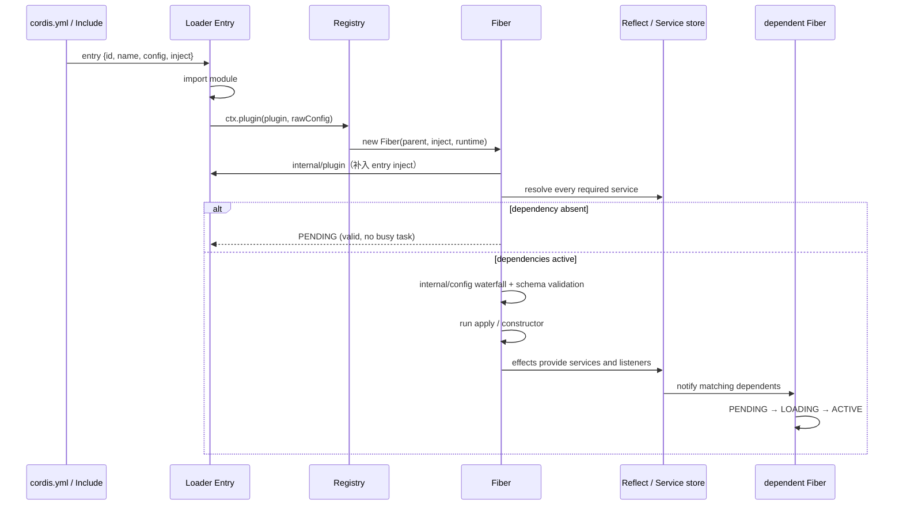
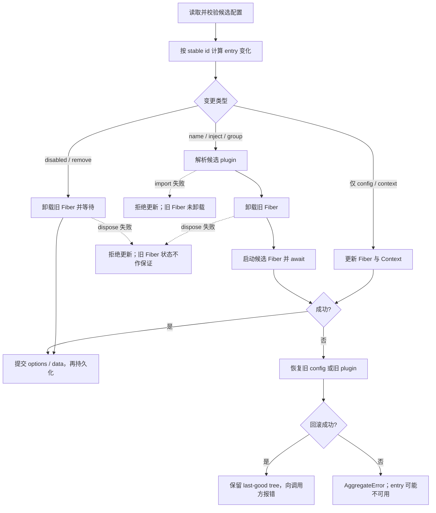
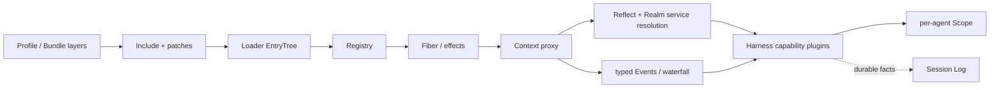

# Cordis 运行时：配置里的插件怎样变成运行实例

> 研究快照：DeepSeek Harness `47f943859bef60e4160492346772ded9b24f765a`（2026-08-13）。本文把源码和已实施 Agent Note 视为事实来源；提交前因只在有记录时陈述。

证据标记：未特别标注的陈述是源码或文档可直接确认的事实；【合理推断】是证据支持但作者没有明说的解释；【未知】表示仓库没有给出答案。

上一章已经把 Profile 和 Bundle 还原成一棵插件树。树只是清单。接下来的问题更麻烦：两个插件都叫 `shell` 时该用哪一个？提供方晚到，消费方要不要先跑？插件启动到一半失败，已经注册的监听器由谁收拾？Cordis 回答这些运行时问题。

## 先记住五个结论

1. “Everything is a plugin”并不等于“没有框架机制”。DeepSeek Harness 的产品功能几乎都能替换，`Context`、服务解析、Fiber、effect 和事件分发仍由 Cordis 提供。【合理推断】官方所说的“没有 privileged core”，更接近“没有必须修改才能扩展的产品模块”，不是说运行时没有内核。（`docs/architecture.md:9-13`；`vendor/cordis/src/context.ts:70-83`）
2. `Context` 不只是依赖注入容器。它还携带服务 realm、调用者 Context 和当前 Fiber 的父链。普通属性读取经过代理，但“没有声明 `inject` 就一定报错”并不准确：祖先 Fiber 已持有的服务可以沿同一 realm 继承，`ctx.get()` 也允许显式探测可选服务。（`vendor/cordis/src/reflect.ts:133-170,225-242`；`docs/cordis-tutorial/03-services.md:80-90`）
3. Fiber 记录插件的生命周期和清理责任。每次 `ctx.plugin()` 都创建一个 Fiber；子 Fiber 的 disposer 先登记到父 Fiber 的 effect 列表，再对外发布。监听器、服务和插件自建资源也通过 effect 归属到某个 Fiber。（`vendor/cordis/src/registry.ts:293-335`；`vendor/cordis/src/fiber.ts:178-203,216-319`）
4. Loader 的“事务”是补偿事务。候选插件会真实启动，副作用可能短暂可见；失败后系统尽力恢复旧插件或旧配置。回滚也失败时，它会抛出 `AggregateError`，不会假装旧树仍然完整。（`vendor/loader/src/config/entry.ts:194-245`；`.agents/notes/implemented/bug-fix/2026-07-20-config-hot-reload-resilience.md:15-19,29-35`）
5. Cordis 管活着的运行时，Session Log 管持久事实。插件卸载后 Fiber 和 effect 可以消失；凡是需要重放、审计或恢复的模型上下文，不能只存在于 Cordis 事件里。仓库把“模型可见内容必须能从 Session Log 重建”写成了根规则。（`AGENTS.md:102-108`）

## 它在整个 Harness 里的角色

Profile/Bundle 决定“装哪些插件”，Loader 把配置行变成运行中的插件实例，Cordis Core 决定实例何时可运行、能看到哪些服务、卸载时清理什么。Agent Loop、LLM、Tools、Session 都站在这层之上；它们依赖同一套机制，却不必互相导入具体实现。（`docs/architecture.md:15-27,39-47`）

| 层 | 负责什么 | 不负责什么 |
|---|---|---|
| Profile / Bundle | 组合和覆盖配置行 | 插件实例的生死 |
| Loader / Include | 导入模块、维护 EntryTree、热更新和失败补偿 | 业务状态的持久化 |
| Cordis Core | 服务解析、依赖等待、事件分发、effect 所有权 | Session 的可重放事实 |
| Harness 插件 | Agent、工具、模型、策略等产品行为 | 私自发明第二套生命周期 |

去掉 Cordis，项目当然还能写成一个大 Agent Loop，但每种能力都要重新解决装配顺序、Provider 替换、监听器注销和热更新。2026-06-11 的微内核决策明确拒绝另写 Koa 式中间件或可插入阶段机，因为那会复制 Cordis 已有的分发、dispose 和 reload 语义。（`.agents/notes/implemented/architecture/2026-06-11-microkernel-event-taxonomy.md:7-24`）

## 三个核心数据结构

### Context 与 Realm：同名服务靠隔离共存，不靠覆盖

`Context.extend()` 用原型继承创建子上下文，不修改父节点。`Context.isolate(name, label)` 为某个服务名换一枚作用域 symbol；两棵子树使用同一枚 symbol 时共享服务槽，新的 symbol 则得到独立的槽。这里隔离的是解析位置，不保证某个 Provider 一定存在。（`vendor/cordis/src/context.ts:90-125`）

服务表并不是按字符串存储，而是按 isolation symbol 存储 `Impl`：

```ts
interface Impl {
  name: string
  fiber: Fiber
  value?: unknown
  check?: () => boolean
}
// ReflectService.store: isolation symbol -> Impl
```

`Impl` 同时记住值和提供它的 Fiber，所以“服务存在吗”与“提供方还 ACTIVE 吗”可以一起判断。（`vendor/cordis/src/reflect.ts:115-125,208-242`）Loader 又把配置里的 `isolate: { shell: true | "label" }` 翻译成 LocalRealm 或 GlobalRealm：`true` 绑定当前 entry，共享字符串绑定命名 Realm。（`vendor/loader/src/config/isolate.ts:25-68,75-100`）

这里没有常见容器里的“后注册者遮蔽前注册者”。同一 isolation symbol 已有 Provider 时，第二次 `provide()` 会直接报错；两个 Agent 想各自挂载 `shell`、`tools` 或策略服务，必须进入不同 realm。源码里的 `symbols.shadow` 是另一回事：它把服务方法调用重新绑定到调用者 Context，并不负责覆盖 Provider。（`vendor/cordis/src/reflect.ts:277-304`；`vendor/cordis/src/utils.ts:149-172`）

普通的 `ctx.serviceName` 读取会先查当前 Fiber 保存的依赖快照，再沿父 Fiber 向上找；realm 变化时停止。当前 Fiber 没写 `inject`，但父 Fiber 已经持有该服务时，读取仍可能成功。若插件只是想探测可选能力，仓库教程要求用 `ctx.get('serviceName')`，由调用者显式接受 `undefined`。（`vendor/cordis/src/reflect.ts:144-170,225-242`；`docs/cordis-tutorial/03-services.md:74-90`）

这种做法没有复制整个容器，只在原型链上替换需要隔离的服务槽。调试时却要同时看 Context 祖先链、service name、Fiber 依赖快照和 realm symbol，普通对象查看器很难一次说明白“这个 Provider 从哪来”。

### Fiber 与 effect：一份插件实例，一条父级清理关系

Fiber 的常见启动路径是 `PENDING → LOADING → ACTIVE`，失败后落到 `FAILED`；卸载会经过 `UNLOADING`，显式移除后才是 `DISPOSED`。Provider 变化时，ACTIVE Fiber 也可能卸载后再次加载，所以这不是一条只能向前走的状态机。（`vendor/cordis/src/fiber.ts:139-154,575-695`）它保留原始配置 `_config`、解析后的 `config`、依赖快照 `store`、当前异步迁移 `inertia` 和 disposer 列表。（`vendor/cordis/src/fiber.ts:178-210`）

Fiber 没有一份公开的 `children` 数组。父子所有权来自更具体的做法：构造子 Fiber 时，Cordis 先把子 Fiber 的 disposer 注册成父 Fiber 的 effect，然后才发出 `internal/plugin`。因此父 Fiber 卸载会带走子 Fiber；Registry 还会按插件 callback 维护另一份 Fiber 索引。把它简称为“所有权树”可以帮助理解，但不能据此假设存在一棵可直接遍历的物理树。（`vendor/cordis/src/fiber.ts:216-319`；`vendor/cordis/src/registry.ts:322-335`）

effect 可以返回一个 disposer、Promise、同步生成器或异步生成器。生成器每次 `yield` 都把一项清理登记进当前 effect。（`vendor/cordis/src/fiber.ts:64-101,356-399`）公开 disposer 是 single-shot；插件卸载也能加入一个已经开始的异步清理，不会因为第二个调用早到而漏等。（`vendor/cordis/src/fiber.ts:110-117,424-560`）

清理顺序很容易看错。同一个 effect 内部的 disposer 按注册逆序逐个执行；Fiber 卸载 sibling effects 时，也会先按注册逆序取出它们，但随后交给 `Promise.all`，异步清理会重叠执行。（`vendor/cordis/src/utils.ts:4-31`；`vendor/cordis/src/fiber.ts:424-441,675-686`）2026-06-18 的 Agent 生命周期 Note 因此要求把“停 Loop、等待最终 flush、移除 Session”放进一个 composite effect。拆成 sibling effects 会让关闭时的 `turn/end` 丢失。（`.agents/notes/implemented/architecture/2026-06-18-agent-lifecycle-and-ownership-contracts.md:19-24,42-46`）

### EntryTree：配置行的稳定身份

Loader 用 `EntryOptions` 描述一行：稳定 `id`、模块 `name`、`config`、`disabled`、`inject`，以及 group 标记。（`vendor/loader/src/config/entry.ts:8-22`）`EntryTree` 持有根 Group 和 `id → Entry` 表，嵌套树用 `:` 解析路径。（`vendor/loader/src/config/tree.ts:6-20,75-94`）

稳定 id 很重要。没有它，文件重新读取时，同一行可能被当成“删旧加新”，本来不需要动的插件也会完整重启。官方教程也把 id 解释成增量更新的身份，而不是显示名称。（`docs/cordis-tutorial/06-composition-and-hmr.md:7-21,50-59`）

## 一次插件启动发生了什么



对应源码顺序是：Registry 规范化函数、类或 `{ apply }` 三种插件形态并创建 Fiber（`vendor/cordis/src/registry.ts:216-228,304-335`）；Fiber 发出 `internal/plugin`，Loader 的监听器据此把 entry 上的 `inject` 合入 Fiber，然后 Fiber 才检查依赖（`vendor/cordis/src/fiber.ts:299-319`；`vendor/loader/src/index.ts:117-123`）；依赖齐全后，Fiber 在执行插件前解析懒配置并做 Standard Schema 校验（`vendor/cordis/src/fiber.ts:641-673`）。

服务注册也是 effect。`provide()` 写入带所有者 Fiber 的 `Impl`；同一 realm 已有实现时，它拒绝覆盖。注销时先移除服务，再等待受影响 Fiber 落稳，最后删除提供方自身的访问快照。（`vendor/cordis/src/reflect.ts:267-305`）声明了这项 `inject` 的消费方会在 Provider 消失时卸载，Provider 回来后再启动。（`vendor/cordis/src/reflect.ts:307-335`；`vendor/cordis/src/fiber.ts:597-638`）

## 事件为何能成为扩展点

Cordis 提供 `emit`、`parallel`、`serial`、`bail` 和 `waterfall` 五种分发方式。（`vendor/cordis/src/events.ts:24-32,177-243`）监听器注册本身是 effect，因此插件卸载会自动移除监听器。（`vendor/cordis/src/events.ts:245-301`）

最值得解释的是 waterfall。它把监听器组成环绕调用：监听器调用 `next()` 才会进入下一层；直接返回就是有意短路。这个能力适合 `agent/request`、`tools/execute`、审批决策等可包装、可替换的步骤。它比固定回调列表灵活，也比让每个插件直接改 Agent Loop 更守边界。（`.agents/notes/implemented/architecture/2026-06-11-microkernel-event-taxonomy.md:13-20`）

代价是语义靠纪律维持。一个只想打日志的监听器漏掉 `next()`，会悄悄吞掉后续逻辑。仓库不得不把“必须调用 `next()`”写进根规则和教程。（`docs/cordis-primer.md:28-34`；`docs/cordis-tutorial/04-events.md:94-140`）

事件还有作用域过滤。dispatch 可接收显式 `thisArg`，再用它的 `Context.filter` 筛选 listener 所属 Context；`global` listener 绕过过滤。（`vendor/cordis/src/events.ts:158-175`）Cordis 只提供这个通用钩子。下一章的 per-agent Scope 会把“这条事件属于哪个 Agent”装进它。

## Loader 如何更新并失败回滚



单 Entry 更新先构造 candidate。若只改 config/isolate/intercept，就调用 `_patchContext()`；失败后用旧 options 再跑一次，完成补偿。（`vendor/loader/src/config/entry.ts:141-211`）若变更 name、inject 或 group，则进入 Fiber 替换路径；只有 name 变化才先 import 新模块，否则复用原 plugin callback。导入失败发生在旧 Fiber 卸载前，所以旧实例仍在。旧 Fiber 卸载成功后，候选启动失败才会触发“重启旧插件”的补偿；如果卸载本身报错，Loader 会恢复旧 options 并上报 `dispose` 错误，但代码没有再启动旧 Fiber 的步骤。（`vendor/loader/src/config/entry.ts:214-245`）

Group 更新会并发启动候选行，收集全部结果；任一失败就删除新增行，并按旧配置重建原 entry。（`vendor/loader/src/config/group.ts:59-105`）Include 在内存副本上解析和打 patch，`root.update()` 成功后才提交 `content` 与 `data`。（`vendor/include/src/index.ts:240-264,296-320`）程序化 create/update/remove 也在成功后才 `write()`。（`vendor/loader/src/config/tree.ts:96-142`）

这不是隔离事务。插件发出的网络请求、文件写入和对外通知无法统一做快照；候选 effect 在失败前也可能被其他插件观察到。官方 Note 承诺的是生命周期落稳和失败补偿，并明确拒绝保证中间过程不可见。（`.agents/notes/implemented/bug-fix/2026-07-20-config-hot-reload-resilience.md:17-19,23-29`）

并发是另一个真实代价。`EntryGroup.update()` 本身不可重入，Include 必须用 per-Include Promise queue 串行化所有子树变更。（`vendor/include/src/index.ts:216-229`）这来自一次具体事故：HMR 初次扫描与 Include 初始 apply 交错，回滚又等待 HMR teardown，进程最终静默退出 13。修复同时加入队列和主 watcher 的 `ignoreInitial: true`。（`.agents/notes/implemented/bug-fix/2026-08-03-hmr-initial-scan-boot-deadlock.md:7-23`）该 Note 仍记录一个窄窗口：失败的首次 apply 期间若真人恰好修改配置，类似等待环仍可能出现。（`.agents/notes/implemented/bug-fix/2026-08-03-hmr-initial-scan-boot-deadlock.md:33-37`）

## 为什么把 Cordis 源码放进仓库

【事实】仓库在 2026-06-11、Agent Loop 代码落地之前就选择 vendor，没有经历“先依赖 npm，后来再迁移”的阶段。提交 `72688a3888` 一次引入 Cordis Core、Loader、Include、Group、HMR 等框架层。决策 Note 写明，当时 Core 仍是 `4.0.0-rc.6`，Agent Loop 的正确性又依赖 Fiber、effect disposal 和 waterfall 的具体语义；npm RC 升级可能改变底座，而仓库需要本地修复路径。（`.agents/notes/implemented/process/2026-06-11-vendor-cordis-as-source.md:7-20`；提交 `72688a3888`）

【事实】他们没有把全部传递依赖复制进来。`js-yaml`、`chokidar`、Standard Schema 等仍走 npm；只有会影响运行时语义的框架层被锁定。（`vendor/README.md:13-27`）同步仍是人工过程：复制上游源码、重放本地改动、更新 SHA，再跑测试和构建。（`vendor/README.md:52-60`）

【事实】vendoring 很快从“锁版本”变成“共同演进底层”。几次代表性变化是：

- `c5b1a7941f`（2026-07-12）修补 Fiber 构造、重入 dispose 和异步清理所有权；当前修改清单概括了 setup 失败回滚、卸载期间拒绝新增 effect、子 Fiber 先归属再发布等行为。（`vendor/README.md:38`）
- `195f7fa9af`（提交日期 2026-08-02，主题为 transactional config reload）把 Entry/Group/Include 更新改为可等待的补偿事务；`0a297c39d3` 随后补上并发组合的错误收集。（`vendor/README.md:40`）
- `7e3a82eacc`（2026-08-10）把配置解析推迟到 inject 就绪之后，Provider 替换时会重新求值原始表达式。（`vendor/README.md:47`）
- `6fb226ea24`（2026-08-11）让 `disabled: !!js` 在每次挂载判断时求值，解决 Windows overlay 被 preset 后层重新启用的问题；其他 entry 元数据仍保持字面值。（`.agents/notes/implemented/architecture/2026-08-11-loader-entry-disabled-interpolation.md:7-21`）
- `ec601ca13d`（2026-08-10）把 vendored 包整体改到 `@deepseek-ai` scope。当前源码不再沿用最初 Note 所说的上游 npm 名称；这是后续发布所有权变化，不应拿旧 Note 描述现状。（`vendor/README.md:3-5,49`）

【合理推断】Cordis 已不是普通第三方库，而是 DeepSeek Harness 自己承担维护责任的框架边界。依据不是宣传语，而是本地修改已经触及 Fiber 正确性、Loader 事务和配置求值时机。换回上游 npm 包不再只是改依赖版本，而要先上游化或放弃这些语义。

【未知】仓库没有完整记录“为什么在 Cordis、Awilix、Inversify、自研容器之间最终选 Cordis”。现有 Note 只能证明团队不想重写中间件、dispose 和 reload，不能证明他们做过一份系统竞品评估。

## 我欣赏的设计，以及它带来的成本

我最欣赏的是“注册即 effect”。服务、事件和子插件没有各写一套 teardown API，清理责任都落到 Fiber。插件替换和 Agent 生命周期因此能走同一条卸载路径。（`vendor/cordis/src/service.ts:32-58`；`vendor/cordis/src/events.ts:245-301`；`vendor/cordis/src/fiber.ts:265-297`）

依赖也不是一次性的启动排序。Provider 消失会让声明了依赖的 consumer 卸载，新的 Provider 出现又会触发加载。对可替换的 LLM、Shell、Persistence Provider 来说，这比写死 boot 顺序更合适。（`vendor/cordis/src/fiber.ts:597-638`；`docs/cordis-tutorial/03-services.md:59-78`）

成本也不少：

- PENDING 是合法状态，所以缺依赖的插件可能什么都不打印并直接退出。教程只能教读者枚举 Fiber 来诊断。（`docs/cordis-tutorial/06-composition-and-hmr.md:61-109`）
- Proxy、prototype Context、declaration merging 和 symbol Realm 叠在一起，换来了局部隔离，也抬高了调试和学习成本。尤其要分清 ancestor lookup、isolation 和 `symbols.shadow`，它们都影响“当前调用看到哪个 Context”，却不是同一种机制。（`vendor/cordis/src/reflect.ts:133-170`；`vendor/cordis/src/utils.ts:149-172`）
- `!!js` 的实现是 `new Function` 加 `with/eval`。它适合受信任的本地配置，不应被当成可接收陌生人输入的安全 DSL。（`vendor/loader/src/config/utils.ts:3-20`）
- HMR 读取 Node 22/24 的内部 ModuleLoader，并为两个版本维护不同接口；拿到内部 loader 失败时 HMR 直接拒绝启动。Node 内部接口一变，这层适配就要跟着改。（`vendor/loader/src/internal.ts:47-102,120-131`；`vendor/hmr/src/index.ts:118-125`）
- 文档自身还有一处小裂缝：Cordis Core 明明支持五种模式，Primer 的分发表只列四种，漏了 `bail`；教程第 4 章才列全。（`vendor/cordis/src/events.ts:24-32`；`docs/cordis-primer.md:15-25`；`docs/cordis-tutorial/04-events.md:80-90`）

如果重新设计，我不会推翻 Cordis。更值得补的是诊断面：在 Loader settlement 后输出“哪些 Fiber 仍 PENDING、缺哪个 service、处在哪个 realm”，并把补偿事务的短暂可见性做成结构化事件。现在这些事实散在 Fiber、Reflect 和 Loader 里，出错时读者得自己拼。

## 模块依赖



Cordis 把静态插件配置变成可启动、可等待、可卸载的 Fiber。可同一个 Web Host 同时跑多个 Agent 时，哪些监听器和服务只属于其中一个？下一章会看 Agent Scope 怎样把 Context、Realm 和事件过滤用于 per-agent 隔离。

## 审查记录

本轮对抗性审查抽查了 14 条结论，覆盖 Context 读取、同名服务、Fiber 父子所有权、两层 effect 清理顺序、Loader 的单 Entry 与 Group 补偿、候选副作用可见性、回滚失败、Include 串行队列、HMR 死锁、vendoring 动机与五次后续改动。修正事实问题 2 处：未声明 `inject` 的属性读取并非一律失败；Loader 也不是所有失败都会进入恢复旧插件的补偿路径。补足事实边界 3 处：同 realm Provider 不会自动遮蔽、Fiber 没有公开子节点树、sibling effects 逆序取出后并发清理。另有 2 处解释降为【合理推断】或改成更窄的源码事实。文风上删掉了宣传式“亮点”和几处笼统判断，保留第一人称观点。

## 文件覆盖率

“核心选定文件”包括 Cordis Core 全部源码、Loader 全部源码、与配置事务直接相关的 Include/HMR/Group、英文教学文档及六份直接 Agent Note。中文文档是英文源的配对翻译，不重复计入分母。本轮用快照 `47f9438` 重新核对了各文件的 `wc -l` 和合计数；表中的 100% 表示初稿把整份文件纳入阅读范围，不等于每行都经过本轮独立复核。

| 文件或文件组 | 总行数 | 初稿申报已读行数 | 覆盖率 | 未读原因 |
|---|---:|---:|---:|---|
| `vendor/cordis/src/context.ts` | 146 | 146 | 100% | — |
| `vendor/cordis/src/events.ts` | 352 | 352 | 100% | — |
| `vendor/cordis/src/fiber.ts` | 754 | 754 | 100% | — |
| `vendor/cordis/src/index.ts` | 14 | 14 | 100% | — |
| `vendor/cordis/src/logger.ts` | 270 | 270 | 100% | — |
| `vendor/cordis/src/reflect.ts` | 418 | 418 | 100% | — |
| `vendor/cordis/src/registry.ts` | 337 | 337 | 100% | — |
| `vendor/cordis/src/service.ts` | 115 | 115 | 100% | — |
| `vendor/cordis/src/utils.ts` | 287 | 287 | 100% | — |
| `vendor/loader/src/index.ts` | 202 | 202 | 100% | — |
| `vendor/loader/src/internal.ts` | 132 | 132 | 100% | — |
| `vendor/loader/src/config/entry.ts` | 303 | 303 | 100% | — |
| `vendor/loader/src/config/group.ts` | 129 | 129 | 100% | — |
| `vendor/loader/src/config/isolate.ts` | 173 | 173 | 100% | — |
| `vendor/loader/src/config/tree.ts` | 166 | 166 | 100% | — |
| `vendor/loader/src/config/utils.ts` | 32 | 32 | 100% | — |
| `vendor/include/src/index.ts` | 377 | 377 | 100% | — |
| `vendor/hmr/src/{index,error}.ts` | 612 | 612 | 100% | — |
| `vendor/group/src/index.ts` | 3 | 3 | 100% | — |
| `vendor/{README,cordis/README,loader/README}.md` | 209 | 209 | 100% | — |
| `docs/cordis-primer.md` + 8 篇英文 tutorial | 843 | 843 | 100% | — |
| 6 份 Cordis 生命周期/配置 Agent Note | 216 | 216 | 100% | — |
| **合计** | **6,090** | **6,090** | **100%** | **达到范围要求（≥90%）** |

## Humanizer-zh 自检

直接性 9/10，节奏 9/10，信任度 9/10，真实性 9/10，精炼度 9/10，总分 45/50。保留的长段主要用于解释 Loader 补偿事务与 vendoring 演进；正文已删除宣传式判断、模糊归因和机械判断卡。
