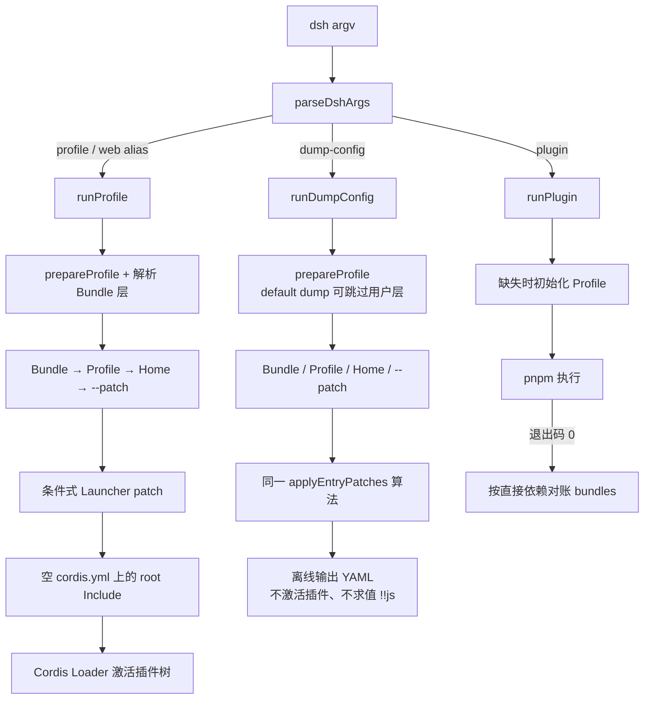
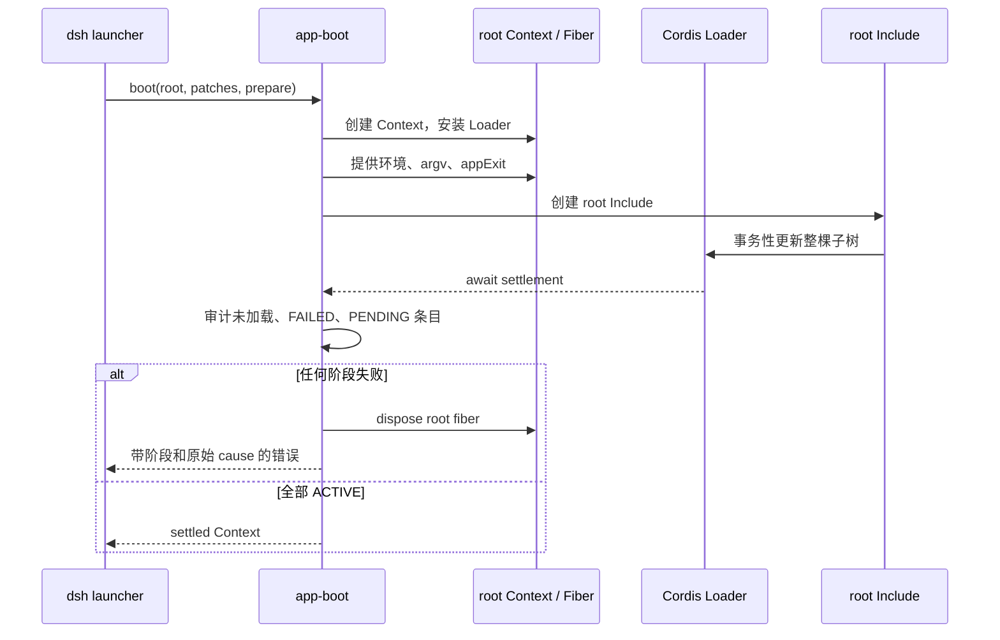

# 模块 2：Profile / Bundle，把配置变成一门装配语言

> 研究快照：`deepseek-ai/deepseek-harness@47f943859bef60e4160492346772ded9b24f765a`（2026-08-13）。本章里的“现在”只指这个提交。

证据标记：没有特别标注的陈述，是源码、测试、提交或当前文档可以直接确认的事实；【合理推断】表示证据支持这种解释，但作者没有明说；【仍然未知】表示仓库没有给出答案。

架构总图告诉我们，DeepSeek Harness 是一棵插件树。可它没有回答更实际的问题：这棵树由谁挑选，又如何把同一套内核装成 Web 或一次性命令？答案在 Profile / Bundle。

先记住四件事：

- Profile 是 `$DSH_HOME/profiles/<name>` 下的一组启动文件：它保存依赖、Bundle 顺序和用户 patch。
- Bundle 是可分发的配置层：一个 npm 包声明自己贡献哪份 `cordis.patch.yml`。
- `dsh` 不内置完整应用树。它在一个空 root 上按顺序叠 patch，再交给 Cordis Loader。
- Web 和 headless 共享 `dsh-base`；它们的区别主要是后续 Bundle 插了什么、改了什么。

## 它在整个系统里做什么

【已证实】早期 `dsh` 把 `base.cordis.yml`、`web.cordis.yml` 和几套入口写死在 CLI 中。第三方包即使能提供 Cordis 插件，也没有地方贡献默认装配，更无法给某个已发布的应用安装插件。Profile / Bundle 把“运行哪棵树”从 CLI 代码移到了用户目录和 npm 包的 manifest 中（`.agents/notes/implemented/architecture/2026-08-05-profile-plugin-bundles.md:7-19`）。

本文把它称为一门小型装配语言。Bundle 发行插件行，Profile 决定层顺序，patch 处理覆盖，`!!js` 读取启动时信息。最后得到的仍是普通 Cordis 插件树，没有第二套运行时协议（`docs/architecture.md:15-37`）。

这一层让 Web、headless 和第三方 TUI 复用同一个 base，也让 CLI 不必认识每一种应用。它解决的是应用装配和分发，不只是 YAML 去重。

## 两份 manifest，一条装配链

理解这两个数据结构就够了：

```ts
interface DshBundleManifest {
  patch: string
}

interface DshProfileManifest {
  bundles?: string[]
}
```

Bundle 的 `package.json` 用 `dsh.bundle.patch` 指向自己的 patch；Profile 的 `package.json` 用 `dsh.profile.bundles` 保存有序包名。运行时把每个包展开为 `ProfileLayer { packageName, packageDir, patchPath, patches }`，最后得到 `Profile { dir, layers, patchPath, patches }`（`packages/boot/app-boot/src/profile.ts:41-96`）。

| 对象 | 存在哪里 | 谁维护 | 回答的问题 |
|---|---|---|---|
| Bundle | npm / Git / 本地包 | Bundle 作者 | “这个包贡献哪些插件行？” |
| Profile | `$DSH_HOME/profiles/<name>` | `dsh plugin` 与用户 | “这次启动按什么顺序装哪些 Bundle？” |
| 用户 patch | Profile 目录与 `$DSH_HOME` | 用户 | “我想怎样改默认装配？” |

`web` 和 `headless` 是内置模板。前者初始化为 `dsh-base + dsh-web-app`，后者是 `dsh-base + dsh-headless`。其他名字不会在普通启动时自动初始化；目录缺失会报错，官方 CLI 路径是先运行 `dsh plugin --profile <name> ...` 创建它（`packages/boot/app-boot/src/profile.ts:98-168,371-403`）。

## 从 `dsh` 命令到插件树



### 1. CLI 只做分流

`bin.ts` 把三种模式动态导入，插件管理和 dump 路径不会顺带加载整个应用（`apps/cli/src/bin.ts:27-52`）。Launcher 只解析 `--profile`、`--patch` 和 dump 选项；遇到第一个不认识的 token 后，剩余参数原样交给应用插件。于是 `--port` 属于 Web Bundle，任务文本属于 headless Bundle，第三方 TUI 也能自己增加 `--resume`，不用修改 `dsh`。这条分界有一个使用约束：Launcher flags 必须写在应用参数之前，首个应用参数若恰好是 `web` 或 `plugin`，仍会被 Commander 当成子命令（`apps/cli/src/args.ts:1-15,112-180`；`.agents/notes/implemented/architecture/2026-08-06-app-owned-command-line.md:42-50`）。

这条边界是在 Profile 之后补上的。最初应用虽可安装，CLI 仍硬编码 Web 的参数和目标行；8 月 6 日的 app-owned command-line 决策把参数快照放进 `ctx.cmdlineArgs`，让普通 provider 插件解析，再用服务注入释放依赖行（`.agents/notes/implemented/architecture/2026-08-06-app-owned-command-line.md:7-21`）。

### 2. 找到 Profile，同时修好模块解析

Profile 名称只能是单个安全目录名，`/`、`\`、`.`、`..` 和保留名 `node_modules` 都会被拒绝（`packages/boot/app-boot/src/profile.ts:98-111`）。

Bundle 有两个解析锚点：先找当前 `dsh` 安装，再找 Profile 自己的 `node_modules`。这保证内置 `dsh-base` 不会被 Profile 里同名的包偷换，外部 Bundle 又能由 Profile 的 pnpm 安装（`packages/boot/app-boot/src/profile.ts:314-355`）。

每次启动还会维护 `$DSH_HOME/profiles/node_modules` 的扁平 symlink fallback，把 `dsh` 安装依赖闭包里的包链接进去。按仓库约定把 Cordis 和 Service Definition 声明为 peer 的外部插件，会落到安装内的同一份实例（`packages/boot/app-boot/src/profile.ts:204-255`）。这层修复不是包管理器：正确链接会保留，安装搬家后会改指向；已经失效且名称未复用的旧链接不会主动清扫，目标位置若是实体目录则直接报错（`packages/boot/app-boot/src/profile.ts:170-202,217-219`）。

### 3. Patch 的确切顺序

【已证实】正常启动的顺序是：

1. `dsh.profile.bundles` 中的 Bundle patch，按清单顺序。
2. `$DSH_HOME/profiles/<name>/cordis.patch.yml`。
3. `$DSH_HOME/cordis.patch.yml`，它覆盖所有 Profile 的机器级偏好。
4. 每个 `--patch`，按 argv 顺序。
5. 启动器自己的末端 patch：组合中存在 `agent-presets` 行时补入内置 Preset 根；存在遥测行且 `DSH_TELEMETRY_DISABLED` 非空时，强制禁用该行。

前四层直接见 `composeProfile()` 和 `allPatches()`；末端 patch 在同一函数里追加（`apps/cli/src/profile-boot.ts:121-170`）。应用参数不在这条链里，它们是启动前提供的服务，配置表达式在对应行真正激活前才读取（`apps/cli/src/profile-boot.ts:248-258`）。

`--dump-default-config` 故意不解析用户 Profile patch，因此它能在用户文件损坏时充当恢复诊断；普通 `--dump-config` 才加入 Profile、Home 和 CLI overlay。两者调用 Include 自己的解析与 patch 算法，不启动插件，也不求值 `!!js`（`apps/cli/src/dump-config.ts:21-51`；`packages/boot/app-boot/src/index.ts:348-441`）。

### 4. Patch 不是深合并

这是整章最容易误读的地方。

`applyEntryPatches()` 先为所有行建立 `id -> row` 索引。`insert` 可以追加顶层行或 group 子行，新插入的行会立即进入索引，供后续 patch 命中。普通 patch 找到 `id` 后，把 patch 提供的顶层字段直接赋给原行；因此 `config` 整块被替换，不会递归合并（`vendor/include/src/index.ts:43-127`）。

```yaml
# 原行
- id: webserver
  config: { host: 127.0.0.1, port: 3080 }

# 后层 patch
- id: webserver
  config: { port: 8080 }
```

结果只有 `{ port: 8080 }`，`host` 不会保留。Web Bundle 在文件头要求 patch 重述该行保留的全部字段（`packages/bundle/web-app/cordis.patch.yml:1-12`）。目标不存在、非 `insert` patch 没写 `id`，或 `name` 与目标行不符时，Include 会警告并跳过，不会中止整次装配（`vendor/include/src/index.ts:80-119`）。

Patch 也没有“删除整行”操作。上层若不想激活某个下层插件，只能把该行设为 `disabled: true`；Web 正是这样关掉 base 的 agent-plane 行。相反，`dsh plugin ... remove` 删除的是 Profile 的包依赖，并在 pnpm 成功后把对应 Bundle 从有序清单中移走。这两个“删除”发生在不同层（`vendor/include/src/index.ts:144-155`；`packages/bundle/web-app/cordis.patch.yml:276-285`；`apps/cli/src/plugin.ts:47-90`）。

这解释了为什么所有层必须压平后交给同一个 Include。旧方案尝试嵌套 Include，外层 patch 无法跨 Include 边界命中内层行；7 月 29 日的设计记录明确把它列为被实测否决的方案（`.agents/notes/implemented/simplification/2026-07-29-shared-base-config-overlays.md:15-37`）。

### 5. 空 root 不是多余文件

每次启动，`prepareProfile()` 都会把 Profile 下的 `cordis.yml` 重写成空数组。真正的应用树全在 patches 中。这个实体文件给 Loader 一个 Profile 目录下的 `baseUrl`，也防止 Loader 的配置写回把已组合行固化进 root，导致下次启动重复插入（`apps/cli/src/profile-boot.ts:59-103`）。

随后 `mountRootInclude()` 注册内置 `cordis:include` 和 `cordis:group`，创建固定 id 为 `include` 的根条目，并保存这一个 Entry，供用户 patch HMR 更新（`packages/boot/app-boot/src/index.ts:475-529`）。固定 id 让失败链和快照诊断稳定；内置 group 则让 Profile 外的组合也能表达共享 isolate realm。

## 同一个 base，两个应用

| | Web Profile | Headless Profile |
|---|---|---|
| Bundle 栈 | `dsh-base` + `dsh-web-app` | `dsh-base` + `dsh-headless` |
| 入口参数 | `--host`、`--port`、`--trusted-host` | 一段任务文本 |
| 新增运行面 | Webserver、API、存储、浏览器插件 roster | Code runtime、startup provider、one-shot runner |
| Agent 装配 | 禁用 base 的 agent-plane 工具行，改由每个 Session 的 Preset 挂载 | 直接使用 base 的全局模型与工具行 |
| 生命周期 | 长驻，Loader 完全 settle 后才打印 URL | 创建一个 Agent，等到 idle，flush Session，输出后请求退出 |

Web Bundle 很厚：它插入 Host 与浏览器两侧的插件，还把 base 中面向单 Agent 的工具行禁用，让每个 Web Session 从自己的 Preset 装配 Agent（`packages/bundle/web-app/cordis.patch.yml:43-173,276-424`）。启动 provider 先发布 `webStartup`，`webserver` 和 `web-runtime` 才读取参数；`--help` 不发布服务，因此服务器不会绑定端口（`packages/bundle/web-app/src/startup.ts:39-82`）。

Headless 没有 Host、HTTP 或浏览器层。它覆盖 persona 和 tools mode，关闭共享模块 HMR，并插入 Code runtime、`headless-startup` 与 runner（`packages/bundle/headless/cordis.patch.yml:1-35`）。Runner 等整个 Loader settle 后才创建 Agent，提交一条普通用户消息，flush Session，再从自己的事件区间取最后一段回答和 `turn/end` 原因（`packages/bundle/headless/src/index.ts:90-149`）。

两者的底层都是 `dsh-base`，分歧集中在后续装配和进程生命周期。

## 插件安装：DSH 与 pnpm 各管哪一半

`dsh plugin` 是 pnpm 的薄封装：

- pnpm 管下载来源、版本、依赖、lockfile 和安装脚本。
- DSH 管 Profile 初始化，pnpm 成功后检查每个直接 dependency 是否声明 `dsh.bundle.patch`，再对账有序 `bundles` 清单。
- Cordis 管 Bundle 插入的插件如何依赖、启动、回滚和卸载。

实现先把相对 `.`、`../x`、`file:`、`link:` 规格锚定到用户调用 `dsh` 的目录，再以 Profile 为 cwd 同步执行 pnpm。只有退出码为 0 才会 reconcile；某个直接依赖在升级后新加 Bundle 声明，也会在下一次成功命令后自动加入清单。反过来，只手改 `dsh.profile.bundles` 不会安装包；包解析不到或声明的 patch 文件读不了，要到 Profile 加载时才失败（`apps/cli/src/plugin.ts:30-90,93-157`；`packages/boot/app-boot/src/profile.ts:344-355,371-402`）。

宿主必须另装 pnpm。Git 依赖的 `prepare` 会在安装时执行包内代码，而且位于 Agent sandbox 之外；pnpm 10 要求用户先在 Profile 的 `pnpm-workspace.yaml` 中显式 `allowBuilds`。这是一项主机级信任授权，不应只因为包能被 Bundle 加载就默认允许（`docs/user/develop/basic/publish.md:163-173`）。官方后来删掉独立的 Repository Plugin 下载、缓存和 wrapper 协议，只保留 Bundle + pnpm，理由是旧路径复制了安装、配置和失败身份，却只能表达更少的插件配置（`.agents/notes/implemented/simplification/2026-08-09-remove-repository-plugin.md:7-38`）。

## 启动为何不容易留下半棵树



`boot()` 在任何配置行挂载前先运行 host prepare，随后挂 root Include、等待 Loader、逐项审计激活状态。失败会先 dispose 整个 root fiber，再把阶段、行链和最深 cause 包进错误；因此不会把“进程还活着但应用只启动了一半”当成成功（`packages/boot/app-boot/src/index.ts:727-801`）。晚到的 detached rejection 由 `installFailLoud()` 接住，它给插件树最多两秒释放终端再退出（`packages/boot/app-boot/src/index.ts:574-649`）。

CLI 更早就注册 SIGTERM / SIGINT，连启动窗口也覆盖。正常关闭、应用主动退出和信号共享一个 controller；dispose 最多等五秒，第二个信号立即升级为强制退出（`apps/cli/src/profile-boot.ts:207-225`；`apps/cli/src/process-shutdown.ts:22-76`）。Web 打印 URL、headless 创建 Agent 前都额外等待 Loader settle，避免把“某个兄弟行稍后失败”误报成应用已就绪（`packages/bundle/web-app/src/index.ts:159-183`；`packages/bundle/headless/src/index.ts:96-105`）。

两份用户 patch 都会被精确路径 watcher 热更新。每代配置都 `structuredClone` 后重新从 Bundle 层合成，原因很具体：Include 会修改从 `insert` 进入的对象；若复用旧对象，删掉用户 override 后也回不到 Bundle 默认值（`apps/cli/src/profile-boot.ts:227-245,285-294`）。Include 用队列串行更新；新配置应用失败且回滚成功时，上一棵树继续运行。源码没有承诺“回滚本身失败”时仍能保住旧树，因此这里不能写成无条件保证（`vendor/include/src/index.ts:216-229,296-320`）。

## 这套设计怎样演进出来

以下是有提交与 Agent Note 支撑的演进，不是对作者心理活动的猜测。

| 日期 | 变化 | 证据 |
|---|---|---|
| 7 月 29 日 | 两份高度重复的完整配置先收敛为 shared base + surface overlay；实测后放弃嵌套 Include | `f290a8b851`；`.agents/notes/implemented/simplification/2026-07-29-shared-base-config-overlays.md` |
| 8 月 6 日 | 三个 Bundle 包先落地，随后 CLI 改为启动 Profile、用 pnpm 管理外部 Bundle | `2365b2c54f`、`cd6b4ee3c9` |
| 8 月 6 日 | 首轮 review 暴露 insert 对象复用、过早宣告就绪和依赖闭包不完整；随后加入每代克隆、Loader settlement gate 与 dependency + peer dependency 闭包 | `925daf141b` |
| 8 月 6 日 | 装配路径继续删减重复代码，恢复 home 级 patch，并把 manifest 明确分成 `dsh.profile` / `dsh.bundle` | `0071862d48`、`65770325e7`、`62d0f26fd6` |
| 8 月 6–10 日 | Launcher 不再解析应用参数；Web 和 headless 的普通 provider 插件各自接管命令行 | `37cbd155f5`、`d4ccfbd80f`、`09e2d2ddc1` |
| 8 月 9 日 | Headless 去掉 `dsh-web-app`，改成直接驱动 core Agent / Session | `9d5eb37638`；`.agents/notes/implemented/architecture/2026-08-09-headless-direct-core-entry-point.md` |
| 8 月 9 日 | 删除 Repository Plugin 的第二套安装协议，统一到 Bundle + pnpm | `993550e6c8`；`.agents/notes/implemented/simplification/2026-08-09-remove-repository-plugin.md` |
| 8 月 11 日 | 修补应用快速退出与 patch watcher 建立并发时的误报 | `149a5674be` |

【合理推断】这条路线不像先画好“Profile 产品模型”再一次写完。提交顺序是：先解决两棵配置树复制，随后把 overlay 变成 npm Bundle、把选择权放进用户 Profile，最后再把应用 flags 和下载缓存移出 Launcher。从结果看，Launcher 知道的应用专属信息越来越少；这是对连续 diff 的概括，不是 Agent Note 中的原话。

【仍然未知】公开历史没有说明整块 `config` 替换是长期坚持的用户体验，还是当前 Include 语义下的阶段性取舍；也没有足够证据判断将来是否会给 Bundle 声明版本兼容范围。本文不会替作者补这两段心路。

## 我喜欢的地方，以及让我不安的地方

我最看重的是分发和运行没有绑死。Bundle 只交付 patch，里面装的仍是普通插件；第三方应用不必先向 Launcher 注册新的“应用类型”。`--dump-config` 也复用 Include 的 parser 与 patch 函数，诊断输出和启动树使用同一套 patch 算法。

代价也很具体。

第一，行 `id` 承担了近似跨包引用键的作用，但仓库没有把它声明为稳定 ABI。上游 Bundle 重命名一个 id 时，用户 patch 会收到 warning，应用仍可能继续启动，自定义项却没有生效。仓库当前还是 pre-release，也明确不承诺旧格式兼容，因此不能把这种引用关系写成官方兼容承诺（`AGENTS.md:5-7`）。第二，整块 `config` 替换要求上层复制想保留的字段；Bundle 新增默认值后，旧 patch 不会自动继承。Profile 解析还依赖安装优先解析、Profile-local 解析与扁平 symlink fallback 协作，安装移动或错误 symlink 会增加排查步骤。

如果重做，我会保留显式的 Bundle 顺序和单一 Include，但给 patch 增加一种可选的字段级操作，例如 `configMerge`，并允许 Bundle 声明稳定 id 与配置版本。默认仍用现在的整块替换，避免悄悄改变语义；需要长期兼容的公开 Bundle 才承担更明确的升级契约。这是改进建议，不是当前路线图。

## 读到这里，你应该明白什么

- Profile 保存这次启动的依赖与层顺序，Bundle 交付一层可安装的 patch。
- 层顺序是 Bundle → Profile → Home → CLI overlay → 条件式 Launcher patch；同一个 `id` 后写覆盖先写，`config` 整块替换。
- Web 与 headless 共用 base。Web 加入 Host 和浏览器树，并把 Agent 能力移到每个 Session 的 Preset；headless 直接用 core Agent / Session 完成一次任务。
- pnpm 管安装，DSH 管层清单，Cordis 管激活和清理。错误发生在哪一层，决定了该查 lockfile、Profile manifest，还是 Loader/Fiber。

Profile / Bundle 决定“要挂哪棵树”。YAML 中的一行真正挂载时，依赖何时满足、effects 怎样归属、失败后为什么能撤销，要看 Cordis 的 Context、Fiber 与 Loader 生命周期。

## 审查记录

本轮对抗性审查抽查了 13 条结论：CLI 分流、Profile 路径和模板、Bundle 双锚点解析、扁平依赖 fallback、五层 patch 顺序、按 id 覆盖与整块 `config` 替换、root Include、Web/headless 分工、pnpm/DSH/Cordis 边界、启动审计与失败清理、双 watcher 重组、Include 回滚边界，以及 7 月 29 日到 8 月 11 日的提交链。修正事实问题 3 处：自定义 Profile 并非只能由 `dsh plugin` 创建、末端 Preset/telemetry patch 都有存在性条件、headless overlay 还插入 Code runtime。补足边界 6 处：Launcher 参数顺序、symlink 遗留与实体目录失败、patch 不支持删除行、直接依赖才参与 reconcile、手改 Bundle 清单不会安装包、回滚保留旧树有“回滚成功”的前提。将“row id 是配置 ABI”降为作者分析，并补上仓库没有稳定 ABI 承诺。文风上删掉了“最漂亮”“边界很干净”等宣传式判断，也拆开了几处三段式长句。

## 文件覆盖率

核心选定文件覆盖 CLI、Boot、三套 Bundle、Include patch 算法和直接决策记录；测试只做交叉取证，不计入分母。本轮在快照 `47f9438` 上重新核对了每项 `wc -l` 与 4,990 行合计。Bundle 组合行只统计其 `src/*.ts`、英文 README、`package.json` 与 `cordis.patch.yml`，不含测试、翻译、构建配置和 `node_modules`。表中的 100% 是初稿申报的全文阅读范围，不表示本轮逐行复审了全部 4,990 行。

| 文件 | 总行数 | 已读行数 | 覆盖率 | 未读原因 |
|---|---:|---:|---:|---|
| `apps/cli/src/args.ts` | 191 | 191 | 100% | — |
| `apps/cli/src/bin.ts` | 53 | 53 | 100% | — |
| `apps/cli/src/dump-config.ts` | 53 | 53 | 100% | — |
| `apps/cli/src/plugin.ts` | 158 | 158 | 100% | — |
| `apps/cli/src/process-shutdown.ts` | 77 | 77 | 100% | — |
| `apps/cli/src/profile-boot.ts` | 300 | 300 | 100% | — |
| `apps/cli/reference/README.md` | 84 | 84 | 100% | — |
| `apps/cli/composition.md` | 252 | 252 | 100% | — |
| `packages/boot/app-boot/src/index.ts` | 829 | 829 | 100% | — |
| `packages/boot/app-boot/src/profile.ts` | 420 | 420 | 100% | — |
| `packages/boot/app-boot/src/invariant.ts` | 30 | 30 | 100% | — |
| `packages/boot/app-boot/README.md` | 60 | 60 | 100% | — |
| `packages/bundle/README.md` | 13 | 13 | 100% | — |
| `packages/bundle/base/{src/*.ts,README.md,package.json,cordis.patch.yml}` | 639 | 639 | 100% | — |
| `packages/bundle/headless/{src/*.ts,README.md,package.json,cordis.patch.yml}` | 362 | 362 | 100% | — |
| `packages/bundle/web-app/{src/*.ts,README.md,package.json,cordis.patch.yml}` | 868 | 868 | 100% | — |
| `vendor/include/src/index.ts` | 377 | 377 | 100% | — |
| `.agents/notes/implemented/architecture/2026-08-05-profile-plugin-bundles.md` | 33 | 33 | 100% | — |
| `.agents/notes/implemented/architecture/2026-08-06-app-owned-command-line.md` | 50 | 50 | 100% | — |
| `.agents/notes/implemented/architecture/2026-08-09-headless-direct-core-entry-point.md` | 44 | 44 | 100% | — |
| `.agents/notes/implemented/simplification/2026-07-29-shared-base-config-overlays.md` | 53 | 53 | 100% | — |
| `.agents/notes/implemented/simplification/2026-08-09-remove-repository-plugin.md` | 44 | 44 | 100% | — |
| **合计** | **4,990** | **4,990** | **100%** | **达标 ✅（核心要求 ≥90%）** |

## Humanizer-zh 自检

直接性 9/10，节奏 9/10，信任度 9/10，真实性 9/10，精炼度 9/10，总分 45/50。保留第一人称评价，但把兼容性、风险和作者意图分别落到源码、仓库规则或明确的推断标记上。
