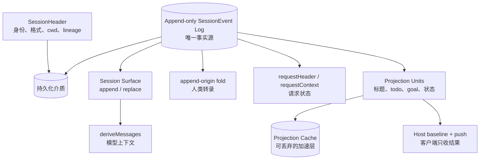
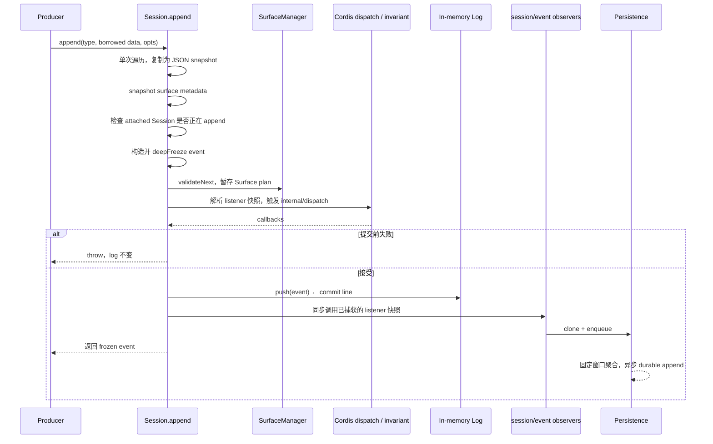
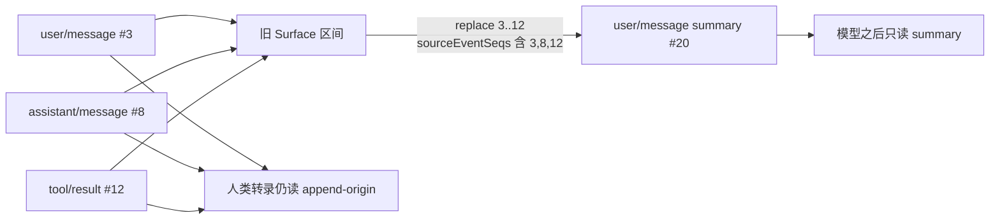

# Session Event Log：为什么它不只是一份 `messages[]`

> 研究基线：`deepseek-harness@47f943859bef60e4160492346772ded9b24f765a`，2026-08-14。本文聚焦 `packages/core/session`，并追到 persistence、projection、cache 和 Host carrier 的边界；不会逐个拆 UI 组件。

上一章跟完了 Agent Loop：输入进入 step，模型流式返回，工具执行，再由 turn 收尾。现在要回答一个更根本的问题：这些过程为什么不能只维护一份 `messages[]`？

因为 `messages[]` 只能回答“下一次给模型看什么”，回答不了下面这些问题：

- 模型回复是怎样一块块流出来的？
- 这个工具是没开始、执行过但结果丢了，还是确实失败了？
- 压缩后模型看不到的旧对话，用户还能不能看到？
- 恢复和 fork 继承了哪一段历史？
- 当时使用的 system prompt、模型参数和 tool schema 是什么？
- UI 上的标题、todo、goal 等状态，能不能在进程重启后重新算出来？

DeepSeek Harness 的回答是：**Cordis 管运行时组合，Session Log 记录可重建的交互事实。模型真正看见的内容，必须已经进入日志，或被日志中的不可变引用确定。** `messages[]` 只是日志的一种读法。这项保证针对模型请求，不等于日志保存了插件代码和全部运行配置。

## 1. 先记住五个结论

1. `SessionHeader` 描述“这份日志是谁、从哪来、用什么格式存”；事件日志描述“交互中发生了什么”。它们一起持久化，但职责不同。
2. `append()` 是同步的内存提交。它会先快照、校验和冻结，再提交，然后通知观察者；磁盘写入由观察者异步排队。
3. 模型历史不是原始日志。`surfaceOp` 把三个消息事件投影为可替换的 Session Surface，`deriveMessages()` 再把 Surface 变成模型请求。
4. 恢复、fork、compaction 和日志派生的 UI 状态不另建事实源。它们从同一份日志选择区间，再做各自的 fold。
5. 日志带来了确定性，也带来体积、重放成本和兼容责任。系统用 chunk packing、批量写入、增量 fold 与投影缓存缓解，而没有删除原始事实。

## 2. 一份 Session，其实有三层



最容易混淆的是 `SessionHeader` 和第一条事件。Header 不在事件列表里，也不会进入 `deriveMessages()`。

| 数据 | 回答的问题 | 典型字段 | 能否由事件重放得到 |
|---|---|---|---|
| `SessionHeader` | 这份日志是谁、格式是什么、存在哪个工作目录、从谁 fork | `version`、`id`、`createdAt`、`cwd`、`parentSession`、`seedLength`、`agentPreset` | 不能；它是日志旁边的存储元数据 |
| `SessionEvent` | 交互过程中发生了什么 | `type`、`seq`、`time`、`data`，以及可选的 `ignorable` / Surface 元数据 | 它本身就是重放依据 |
| 派生状态 | 当前模型、用户或 UI 应该看到什么 | messages、transcript、title、todo、goal | 能；不应反过来成为权威 |

源码依据：`packages/core/session/src/types.ts:33-99,230-435`、`packages/core/session/src/index.ts:425-472`。文档也直接说明 Header 是 “metadata beside the log”：`docs/subsystems/persistence.md:39-94`。

一个细节很重要：`header.seedLength` 是持久化的 fork 血缘边界；`session.firstLiveSeq` 是“这次进程构造时带进来了多少事件”。恢复一份旧日志时，后者通常等于整份已存日志长度，前者仍保留最初 fork 的位置。它们不能合并。`packages/core/session/src/index.ts:450-472`。

## 3. `append()`：这条事实从什么时候算发生

先看清 `append()` 的提交线。这里很容易把同步提交、同步通知和异步落盘混成一件事。



### 3.1 Snapshot：拒绝“校验的是 A，存进去的是 B”

调用者传入的 `data` 是借来的可变对象。`snapshotJsonValue()` 在一次遍历里完成读取、JSON 域校验和复制，拒绝循环引用、稀疏数组、`BigInt`、`NaN`、`-0`、`Date`、Map、类实例等值。这样带状态的 getter 没机会先给校验器一个合法值，再给复制器另一个值。`packages/core/session/src/json.ts:35-190`、`packages/core/session/src/index.ts:604-623`。

随后，完整 event 被 `deepFreeze()`。调用者拿到的是已经进入日志的快照，不再是原对象的别名。`session.events` 返回的数组也会冻结并缓存，下一次 append 后才生成新快照；旧数组不会自己变长。`packages/core/session/src/index.ts:550-560,627-633`。

### 3.2 Validate：所有可能否决提交的检查都放在 `push` 前

Surface 会检查事件类型与 `surfaceOp` 是否匹配、序号是否连续、replace 区间是否存在、来源 seq 是否早于当前事件，以及 replace 是否完整引用了所有被遮蔽节点。`tool/result` 的单点替换只允许改 result content，不能借压缩换掉 call 身份。`validateNext()` 此时只暂存 plan；事件进入 log 后，下一次 Surface 读取或校验才把这个 plan 应用到增量状态。`packages/core/session/src/surface.ts:184-266,286-347,397-459`。

接着，`collectSessionCallbacks()` 调用 Cordis `dispatch('emit', ...)` 解析 listener 快照。Cordis 会先同步触发 `internal/dispatch`；任何一个 internal listener 抛错都会否决本次 append。可选的 invariant 插件在这里校验 turn/step 嵌套和 tool call/result 配对，但只暂存 transition；`log.push()` 后收到 `session/event`，它才推进 trace。`vendor/cordis/src/events.ts:158-175`、`packages/core/session/src/index.ts:374-399,636-647`、`packages/core/session/src/invariant.ts:207-241`。

因此提交线很清楚：

- JSON、Surface、正在开放的 append 重入或同步 `internal/dispatch` 检查失败：`log.push()` 尚未发生，调用者得到异常。
- `log.push()` 之后：事实已经提交。观察者同步 throw 或异步 reject 只会记 warning，不能回滚日志，也不会阻止后面的观察者。`packages/core/session/src/index.ts:374-399,634-654`。

重入还有两种不同结果。`internal/dispatch` 中再调同一 Session 的 `append()`，嵌套调用先被拒绝，若 listener 不吞异常，外层候选也在提交前失败；普通 `session/event` 观察者里的重入同样被拒绝，但观察者异常已经位于提交线之后，只记 warning，外层事件保留，后面的观察者照常收到它。`packages/core/session/tests/session.spec.ts:1421-1460,1509-1546`。

### 3.3 Observe 与 persist：同步通知，不等于同步落盘

`session/event` 是同步观察通道。Persistence listener 在这次调用里把 frozen event 再复制一份，放进该 Session 的 write-behind 队列，然后立刻返回。真正的 backend append 在固定时间窗后异步发生。`packages/session/session-persistence/src/coordinator.ts:1117-1129`、`packages/session/session-persistence/src/write-behind.ts:40-56`。

`session.append()` 返回时只能确认两件事：

- 事件已进入权威的内存日志；
- 提交前捕获的观察者快照已逐个调用。

它**不能**证明磁盘已经耐久。需要这个保证时，调用方必须 `await ctx.sessions.flush(session)`。`flush` 并行等待全部耐久性 listener，等它们全部 settle 后再抛第一个错误。`packages/core/session/src/index.ts:1009-1039`。

Agent Loop 另挂了 checkpoint policy：模型 adapter 真正发请求前、顶层 tool body 真正产生副作用前，以及下一次 pre-step 前，都会先 flush。换句话说，普通 chunk 可以走低延迟 write-behind，外部副作用边界则 fail-closed。`packages/session/session-checkpoint-policy/src/index.ts:20-37,52-82`。

## 4. 为什么日志不能直接等于模型的 `messages[]`

一轮运行至少会产生这些事实：turn/step 边界、原始 chunk、完整 assistant message、tool call/result、请求 header、route capacity、重试与插件自有事件。模型不该看到其中大多数。

DeepSeek Harness 只允许三种事件进入模型 Surface：

- `user/message`
- `assistant/message`
- `tool/result`

`assistant/chunk`、`tool/call`、`turn/*`、`request/*` 和插件的 log-only 事件都保留在日志里，但 `deriveEventMessage()` 返回 `null`。空内容的 assistant message 也不会形成一个空 assistant turn。`packages/core/session/src/surface.ts:14-38,70-114`。

### 4.1 `append` 和 `replace` 让“事实”与“当前上下文”同时成立

Surface 事件必须携带一种操作：

```ts
type SurfaceOp =
  | 'append'
  | { op: 'replace'; start: number; end: number }
```

普通消息追加到尾部。Compaction 则先把摘要过程写成 log-only 事件，再写一个 `user/message` replacement，用新节点遮蔽旧 Surface 区间。原始事件没有删除；变化的是模型读到的有序节点。replace 还必须在 `sourceEventSeqs` 中列出全部被遮蔽节点，因果来源不会消失。`packages/core/session/src/types.ts:338-435`、`packages/core/session/src/surface.ts:210-266,320-379`。



这也解释了为什么人类转录不能直接渲染当前 Surface。用户已经看过的对话不应因 compaction 从屏幕消失。当前 Host 与 Client 会把 `surfaceOp === 'append'` 的 append-origin 事件当作人类转录材料；replacement copy 不会替换这份人类历史。这个边界是在真实 bug 后补上的，commit `d9a11dc91e`，源码说明见 `packages/core/session/src/surface.ts:40-68`。

### 4.2 `deriveMessages()` 是缓存，不是第二份真相

`deriveMessages()` 顺着 `surface.nodes` 调同一个公开的 `deriveEventMessage()`。纯 append 时，它只处理新节点；只要 `replaceGeneration` 变化，就清空缓存并重建。返回值是新数组，但里面共享已冻结的 Message。`packages/core/session/src/index.ts:701-746`。

这比长期维护另一份可写 `messages[]` 安全：

- 没有“日志写成功、messages 忘了改”的双写；
- 外部重建器和运行时缓存使用同一条单节点规则；
- compaction 的语义由日志中的 replace 明确表达，而不是原地删数组；
- 代价只是 replace 后需要重算，普通追加仍是增量成本。

## 5. 请求重建：messages 还不够

模型请求还包含 provider、model、采样参数、reasoning 配置、最终 system prompt 和 tool schema。这些值不在对话消息里，所以 Loop 用完整 `request/header` 快照标出 request epoch。

`requestHeader()` 增量折叠最新 header。日志中的第一个 Loop 实例记 `initial`；新 Loop 实例接手已有 header 的日志时记 `resume`；同一实例内内容真正变化才记 `change`。Header 不变的后续请求没有新 marker，继续使用上一个 epoch。空 system 和空 tools 会规范化为缺省字段，避免等价值产生假变化。`packages/core/session/src/request-header.ts:11-71`、`packages/core/agent-loop/src/agent.ts:458-470`。

概念上，dispatch 前缀决定了这次请求：

```text
request(prefix) = {
  ...foldRequestHeader(prefix),
  messages: 从 prefix 的 Surface 派生
}
```

这里要把生产检查与测试定理分开。生产 invariant 在 `llm/stream` 前对完整 live log 调 `foldRequestHeader(events)`，但 messages 仍来自 live `session.deriveMessages()`；它比较 messages，以及 model、system、temperature、maxTokens、stop、tools 这几项 Header 字段。它没有新建 Session，也没有核对 provider、reasoningEffort 或 adapterDefaults。独立的 fresh-Session 重建出现在测试：测试按每次调用的 dispatch 前缀创建新 Session，再比较 messages，并另行检查一组 Header 字段。`packages/core/agent-loop/src/invariant.ts:19-54`、`packages/core/agent-loop/tests/request-reconstruction.spec.ts:566-613`。

`request/context` 容易被名字误导。它记录实际 route 的 provider/model 和 `contextWindow`，供容量显示与策略使用；它不是模型输入，也不参与 header equality 或请求重建。把容量放进 Header 会让 route metadata 变化伪装成模型请求变化。`packages/core/session/src/types.ts:298-303`、`packages/core/session/src/index.ts:682-699`、`packages/core/agent-loop/src/agent.ts:472-493`。

这里还有两条边界。Agent Note 的原话是 “model-visible ⇔ durably referenced”。纯文本请求由日志折叠；图片等大对象可以由日志里的内容寻址引用确定，再由 attachment store 解析。原则要求可重建，不要求把每个字节塞进 JSONL。`.agents/notes/implemented/architecture/2026-07-05-reconstructable-requests.md:15-35`。

请求可重建也不等于运行环境可完整复原。`request/header` 保存的是已经物化的请求字段，`SessionHeader.agentPreset` 只是一个组合标识；日志没有内嵌插件源码、Bundle/Profile 全量配置或 Provider 实现。要做到字节级复现，还需要引用对象可用，并固定代码和组合版本。代码变化后，日志仍能审计旧请求，却不能保证插件下一次产生同样的行为。

## 6. 恢复、fork 与 seed：都是“拿前缀重新构造”

### 6.1 Seed 不是信任输入

`Session.create(id, seed)` 会逐条验证 seed：完整事件必须是 lossless JSON，`seq` 必须从 0 连续，Surface transition 也必须合法。普通 create 会复制 borrowed graph；Persistence restore 则接管一份新鲜 graph，在原地验证并冻结，省掉第二次序列化复制。任何一条失败，都不能得到半合法的 Session。`packages/core/session/src/index.ts:474-548`。

### 6.2 `session/end-seed` 标出“继承历史到这里结束”

只看持久化字节时，一个未闭合的 `compaction/start` 无法说明它来自已经死亡的旧进程，还是当前仍在执行的工作。为此，只要构造函数显式收到 seed，它就在 seed 后追加一个 log-only `session/end-seed`。构造发生在 Session attach 之前，所以 marker 不会发布到 `session/event`；Persistence 会把它当作 creation seed 的一部分写入。`packages/core/session/src/index.ts:499-547`、`.agents/notes/implemented/architecture/2026-07-30-session-end-seed-log-boundary.md:17-31`。

```text
新 marker 路径：
[ inherited / restored events ... ] [ session/end-seed ] [ this lifecycle's events ... ]
0                                 firstLiveSeq
```

空 seed 也会在 seq 0 写 marker，因此“恢复了一个空 Session”和“全新 Session”仍可区分。若 seed 最后一条已经是 marker，就不再重复写，避免每次只打开看看都让日志增长。`packages/core/session/src/index.ts:539-547`。

它没有复用 `header.seedLength`，因为两者回答不同问题：前者是本次 lifecycle 的构造边界，后者是最初 fork 血缘。这个设计先尝试过 persistence-load 层的 `session/resumed`，后来移到构造函数，因为 load 方案覆盖不了 fork，也把纯读变成了写操作。演进依据：commit `b341155652`；`.agents/notes/implemented/architecture/2026-07-30-session-end-seed-log-boundary.md:7-45`。

边界也不是分布式锁。多个进程同时写同一 Session 时，各自都有自己的 lifecycle，`session/end-seed` 不能证明另一个 writer 是否还活着。Note 明确把并发 writer liveness 留在日志之外。该 Note 第 33-35 行是保证范围，不应外推。

### 6.3 Fork 只接受完整 turn 的前缀

`SessionStore.fork()` 从 live source 取 `0..boundary` 的闭区间，要求 boundary 存在且前缀的最后一个 turn 已闭合。它不会悄悄把开放 turn 截短。Child 复制 seed，并在 Header 中记录 `parentSession`、`seedLength` 与继承的 cwd。`packages/core/session/src/index.ts:1067-1153`、`docs/subsystems/session.md:532-538`。

这项限制不是洁癖。一个开放 step 可能有未配对的 tool call；从中间 fork，会让 child 一开始就拥有 provider 无法接受的 transcript。

### 6.4 Crash recovery 保留已经发生的工作

冷加载若发现完整写入但未闭合的 turn，不会把整个 turn 截掉。`interruptedTurnClosers()` 会先给悬空工具补错误 result，再补 `step/end` 和 `turn/end { kind: 'interrupted' }`。已经记下 `tool/call` 但没有 result，错误码是 `TOOL_OUTCOME_UNKNOWN`，提醒恢复者先检查外部副作用；模型只声明了 call、Harness 还没记到工具开始，则是 `TOOL_NOT_STARTED`。`packages/core/session/src/repair.ts:12-27,77-132`。

只有 torn final record 会被物理层丢弃。完整事件保留，合成 closer 在 cold `load/prepare` 时提交；live Session 若还开着 turn，load 会拒绝，不能把正在运行的工作误修成 interrupted。`packages/session/session-persistence/src/coordinator.ts:891-963,973-989`。

## 7. 持久化：内存领先磁盘，但在关键边界追平

Persistence 是一个 capability seam：抽象服务直接读写 `SessionEvent`，没有第二套“持久化事件 DTO”。JSONL 可以把连续 chunk 编成 packed rows，SQLite 可以一事件一行，但 `load()` 必须还原完全相同的逻辑事件与 seq。`packages/core/session/src/chunk-rows.ts:1-346`、`packages/session/session-persistence/src/index.ts:84-243`。

### 7.1 200 ms 是固定窗口，不是 debounce

第一个 pending event 启动固定 deadline，之后到达的事件加入同一批，但不延长 deadline。这样持续 streaming 不会无限推迟首批落盘。后台写失败时，整批放回队头，暂停自动重试；下一条新事件或显式 flush 再试。`packages/session/session-persistence/src/write-behind.ts:80-115,138-158`。

默认 200 ms 来自一次明确的写放大优化：仓库 fixture 中 chunk 占绝大多数逻辑事件，逐事件 fsync/transaction 太贵。commit `924c954469` 保留了所有事件，只改变物理批次。Agent Note 的测试例是 20 个事件每 10 ms 到达，从 20 次 append 合成 1 次；它也强调这不是通用倍率。`.agents/notes/implemented/architecture/2026-08-08-bounded-session-persistence-write-batching.md:7-33`。

### 7.2 一次 flush 是 quiescence barrier

`SessionWriteBehind.flush()` 先取消 timer，等待正在写的批次，然后持续排空 barrier 期间新进入的事件，直到队列真正为空。并发 flush 复用同一个 Promise。`packages/session/session-persistence/src/write-behind.ts:58-72,117-136`。

后台路径追求吞吐，语义 checkpoint 追求顺序。两者叠加后的真实保证是：

| 时刻 | 已确认 | 仍可能发生 |
|---|---|---|
| `append()` 返回 | 内存日志已提交 | 磁盘仍落后 |
| 后台窗口到期 | 批次开始尝试写入 | backend 仍可能慢或失败 |
| `flush()` 成功返回 | barrier 前及期间进入的事件都已耐久 | 之后的新事件属于下一批 |
| 进程在 flush 前崩溃 | 已完成的旧批次仍在 | 当前内存尾部可能丢失 |

因此 `writeBatchMaxDelayMs` 只限制主动等待，不是 fsync SLA，更不是“最多丢 200 ms”的硬保证。事件循环阻塞、排队和 backend I/O 都会延长真实时间。`docs/subsystems/persistence.md:9-19`。

### 7.3 同一进程内按 SessionId 串行，不等于跨进程互斥

Coordinator 用 per-id Promise chain 保证同一进程里的 create、append、repair、adopt 不交错；backend 成功后才推进 durable cursor。`packages/session/session-persistence/src/coordinator.ts:682-710,1004-1033`。

但它没有把 `session/end-seed` 或 promise chain 变成跨进程锁。文档只说连续外部 writer 可能拖延 revision convergence；并发写同一 artifact 的更强协调，需要 backend 或部署层另行提供。把当前语义当成多写者共识协议，会越过代码保证。

## 8. 版本与未知事件：宁可拒绝，也不静默少读

当前 `SESSION_FORMAT_VERSION = 0`。它是预发布阶段固定使用的格式号，不是“没有版本”，也不承诺兼容旧日志。版本机制的长期规则是：发布后若 Header、事件 envelope、核心事件语义或 Surface 机制发生结构性变化，writer 应递增这个整数；普通插件新增事件不必随之 bump，因为事件词汇取决于插件组合。`AGENTS.md:5-7`、`packages/core/session/src/types.ts:33-56`、`.agents/notes/implemented/architecture/2026-08-10-session-log-version-mechanism.md:11-23`。

读侧先比较 version：

- 相同：正常读取；
- 日志比 reader 新：明确要求升级 Harness；
- 日志比 reader 旧：当前 v0 尚无 upgrader，拒绝读取。

随后检查事件类型。已知类型来自生成的 `KNOWN_SESSION_EVENT_TYPES`；未知事件只有明确携带 `ignorable: true` 才能跳过。默认是 required，因为漏写 ignorable 最多导致过度拒绝，默认跳过却可能让系统带着残缺语义恢复。`packages/session/session-persistence/src/coordinator.ts:1046-1074`。

机制已经能读 `ignorable: true`，但当前 `Session.append()` 还没有给 writer 暴露这个选项，仓库内也没有事件生产者设置它。也就是说，现阶段它主要是一个读侧拒绝规则，不是第三方插件已经可以自由使用的兼容扩展面。`.agents/notes/implemented/architecture/2026-08-10-session-log-version-mechanism.md:19-23`、`packages/core/session/src/index.ts:604-633`。

这里有一个有意的不对称：append 路径不做 known-vocabulary 检查，只拒绝已经退役的 legacy shape。否则一个 out-of-repo plugin 刚写出事件，就可能让当前 live Session 的持久化中途停摆。代价是：本轮可以继续写，下一次 load 会 loud refusal。`packages/session/session-persistence/src/coordinator.ts:682-691`。

当前限制也很具体：仓库外插件的事件不会进入生成目录；在专门的注册机制出现前，first-party reader 会拒绝这类 required event。设计记录没有掩饰这点。commit `9186824e87`；`.agents/notes/implemented/architecture/2026-08-10-session-log-version-mechanism.md:7-30`。

## 9. UI 状态：Host 只算一次，客户端不再重复 fold

Session Projection 主要处理 title、todo、goal、permission 等“从日志算出的当前值”。Domain 插件注册一个同步纯函数单元：

```ts
interface ProjectionDefinition<K extends keyof SessionProjectionMap, S> {
  key: K
  schema: ZodType<SessionProjectionMap[K]>
  init(): S
  apply(state: S, event: SessionEvent): S
  view(state: S): SessionProjectionMap[K]
  stateVersion: number
}
```

Registry 只订阅一次 `session/event`。正常路径里，每个已提交事件依次经过每个 unit。对不关心的事件，unit 应返回同一 state reference；`Object.is` 没变化就不发下游通知。同步是 unit contract，不是隔离机制：`view()` 返回 Promise 会在 schema 处失败，`apply()` 抛错则会中断本次 drive。`packages/session/session-projection/src/index.ts:34-74,155-184,404-425`、`packages/session/session-projection/src/invariant.ts:17-29`。

还有一个反例能防止我们把 Registry 和事件溯源画等号：ApiProxy 注册的 `imageLimits` 不从日志计算，它通过 baseline 携带当前 Host 配置，`apply()` 对所有事件都保持原 state。Registry 是 Host 单点计算与传输机制；只有具体 unit 的定义，才能证明某个值确实可由日志重放。`packages/host/apiproxy/src/api-proxy.ts:1302-1323`。

### 9.1 为什么坚持 Host 单一计算点

如果浏览器也写一遍 domain fold，Host 与客户端会出现两套 transition 逻辑。Plan mode 已经需要同时折 `command/run` 和 `plan/mode`，一旦两边演进不同，刷新前后就会看到两种状态。

当前设计由 Host 得到 finished values：

1. history tail page 带 `{ asOfSeq, values }` baseline；
2. 后续变化通过 `session/projection { key, value, seq }` 推送；
3. 客户端只做“更高 seq 胜出”，不理解业务事件。

ApiProxy 在切 tail page 后同步读取 registry snapshot，中间没有 `await`，因此 events 与 projections 属于同一个 cut。它只承载值，不知道 title、todo 或 goal 怎样计算。`packages/host/apiproxy/src/api-proxy.ts:804-876,1273-1287`、`packages/host/apiproxy/src/api/sessions.ts:264-283`。

这项决策最初记录在 proposed RFC，当前代码已经实现 registry、cache 和 carrier。RFC 只能解释候选方案与取舍，不能替当前代码作证。例如 RFC 写“duplicate keys throw”，现实现允许同一 `stateVersion` 的同 key 注册者共享一个 unit，并用引用计数保活；不同版本才拒绝。`.agents/notes/proposed/architecture/2026-07-27-session-projection-and-command-log.md:7-88,142-187`、`packages/session/session-projection/src/index.ts:186-222`。

### 9.2 Projection Cache 是捷径，不是事实源

每个 cache row 是 `(sessionId, key, ver, seq, val)`。`ver` 与 unit 的 `stateVersion` 不同就丢弃；`seq` 告诉系统它折到了哪里。冷读从最低可用 watermark 的前一条开始取日志 tail，再 forward replay；若 row 声称的位置超过日志结尾，第一次 restore 会拒绝，cache service 随后从 seq 0 重读。列表页的零 I/O 路径更弱：它可以直接显示同版本、同 Session identity 的旧 row，并用最小 watermark 标出这组值至少新到哪里。`packages/session/session-projection/src/index.ts:284-385`、`packages/session/session-projection-cache/src/index.ts:91-130,154-197`。

live Session 写 cache 时，顺序是先 snapshot unit state，再 flush Session Log，最后落 cache，因此正常 live 路径允许 cache 落后，不会让它领先。Detach 是例外：Session 已从 store 移除，cache writer 会跳过 `ctx.sessions.flush()`，durability 交给 Persistence 自己的 retirement drain。此时 row 可能短暂超过 durable log；cold restore 会用 anchored floor 检出 watermark 越界，丢掉 row 并从 seq 0 重算。cache 写失败只记 warning，下一次 checkpoint 或 cold read 再修复。`packages/session/session-projection-cache/src/index.ts:132-196,241-280`、`packages/session/session-persistence/src/coordinator.ts:1139-1161`。

这里还有一个未被现有测试封死的窗口。`cachedSnapshot()` 不读日志尾，因此零 I/O 列表无法自行发现 detach row 越过 durable log。cache 落盘与 Persistence retirement drain 是两条独立的异步收尾路径；如果前者完成后进程退出，代码中暂未看到跨后端的顺序屏障。由此可推断，列表可能短暂展示一份日志尚不能证明的投影值，直到 cold open 触发校验。源码注释把缓存描述为 “stale, never wrong”，但当前代码和测试不足以证明 detach 崩溃窗口也满足这句话。这是【待验证风险】，不是已经复现的故障。

它用事件数/时间做节流，并在 `turn/end` 与 detach 两个位置触发不可省略的 fail-soft 写。在 cold restore 路径，缺失、过期或 watermark 越界的合法 cache row 只会让重放变慢，不应改变结果；这项保证不能直接外推到不读日志的零 I/O 列表。整份存储介质若损坏到无法通过 domain schema，则属于 storage-domain 的打开失败，也不能用“缓存可删”包过去。`packages/session/session-projection-cache/src/index.ts:199-280`、`packages/session/session-projection-cache/src/spec.ts:16-69`。

### 9.3 Projection 的失效边界

这层约束主要靠 unit contract 与 schema，没有 per-unit 隔离。`apply()`、`view()`、schema 或 change listener 任一处同步抛错时，Session event 已经提交，外层 observer containment 只记 warning。当前 drive 是一个顺序循环：抛错点之前的 unit 可能已推进，当前及后面的 unit 可能漏掉该事件。已有 live cell 不会自动回放缺口；更麻烦的是 `snapshot()` 仍以 `session.seq - 1` 作为整组 `asOfSeq`，不会检查各 cell 的 `observedSeq`。因此一次坏 unit 可能让 baseline 对新鲜度报得过头，直到 unit 被卸载重建或进程重启。

Carrier 的 fail-soft 也不是全局规则。`session.list` 与 subagent history 会捕获 projection 失败，省略 projection block 后继续返回；普通 `session.history` 的 projection 失败进入整个 handler 的 `internal` 错误，transcript 不会照常返回。`packages/core/session/src/index.ts:381-399`、`packages/session/session-projection/src/index.ts:248-255,404-425`、`packages/host/apiproxy/src/api-proxy.ts:841-899,1551-1574,2242-2268`。

日志提交与投影推进不是一个事务。要维持正常路径的保证，unit 必须纯、同步、便宜，且不能把异常当普通分支；当前实现也还没有为每个 unit 提供独立的补跑队列。

## 10. 无密钥实验：真的从日志重建模型所见

本仓库已提供 `experiment/inspect-session-replay.ts`。它读取官方 `headless-profile` JSONL fixture，替换 fixture token，调用固定源码快照中的三个公开入口：

- `Session.create()`：把 32 个 fixture 事件作为 seed 校验、复制并构造 Session；构造函数还会在 seed 后加 `session/end-seed`；
- `requestHeader()`：恢复请求 envelope；
- `deriveMessages()`：从 Surface 恢复模型历史。

运行 `./experiment/run.sh` 的结果显示：fixture 含 32 个事件，构造后的 Session 因 end-seed marker 实际有 33 个；其中仍只有 5 个 model-visible 节点。seq 10 的首个 header 前缀得到两条 user 消息；Bash call/result 写入日志后，seq 23 的前缀多出 assistant tool-call 和 user tool-result；最终 transcript 再多一条 assistant 回复。脚本打印的 `events: 32` 来自 seed 数组，不是 `replayed.events.length`。

这直接验证了两件事：fixture 的完整事件集大于模型历史；seq 23 这个 header epoch 的前缀能看见刚完成的工具往返。

它没有走 Persistence backend，因此不能证明 JSONL/SQLite 解码、chunk unpack、write-behind、flush、unknown-event refusal 或 torn-tail repair。脚本还把 `{{system}}` 换成一段占位文本，把 `{{tools}}` 换成空数组；它证明替换后的 header 能 fold，不证明 fixture 录制时的真实 system prompt 和 tool schema 已复原。

脚本把每个 `request/header` 事件打印成 `REQUEST`，但 marker 表示 header epoch，不等于模型调用。生产代码只在 Loop 实例第一次请求或 Header 改变时写 header；同一实例内 Header 不变的后续请求沿用旧快照。这份 fixture 的两个 step 恰好都带 header，因为 reasoningEffort 改了。若要逐请求审计，还要先确定每次真正 dispatch 的日志前缀，不能只数 header。`packages/core/agent-loop/src/agent.ts:458-493`。

## 11. 这版设计怎样演进而来

| 时间 / 提交 | 变化 | 当时解决的问题 |
|---|---|---|
| 06-11 `9b8fccc6f9` | 回填 event-sourced sessions 决策记录 | mutable messages 无法保存 chunk、边界、工具证据与严格 replay；注意这是“回填记录”，不是代码诞生时间 |
| 06-14 `a44f7f3486` | 记录 session persistence seam | 把内存日志变耐久，同时保持 backend 可替换 |
| 06-17 `c5a1c494e7` | 引入 Session Surface | 压缩需要改模型上下文，又不能修改 append-only 事实 |
| 07-06 `a7b569850b`、`a4f7e757fa` | `request/header` 进入日志，消息派生加缓存 | 请求可以重放，也兼顾 provider prefix cache |
| 07-27 `fa331c6399` | 建立 Host projection registry | 避免每个 UI domain 各自做 baseline、event switch 和客户端 fold |
| 07-28 `c330c1cd3e` | 加持久化 projection checkpoint | 冷 Session 不必每次全量读日志 |
| 07-29 `d9a11dc91e` | 人类转录改读 append-origin | 修复 compaction 后旧对话从人类视图消失 |
| 07-30 `b341155652` | seed 生命周期边界写进日志 | 区分继承的未闭合 bracket 与本轮活跃工作，并覆盖 fork |
| 08-08 `924c954469` | 固定窗口批量持久化 | 降低 chunk 密集日志的 fsync / transaction 写放大 |
| 08-10 `9186824e87` | version direction 与 unknown-event refusal | 防止旧 reader 静默跳过新语义，带着残缺日志继续运行 |

【合理推断】这些提交不像一次完成的总设计，更像沿着同一方向逐步补洞：先记录事实，再允许模型上下文替换；随后补人类视图、冷读性能、生命周期边界和兼容拒绝。提交能证明改动顺序，不能证明作者当时已经预想了整条路线。

## 12. 决策、代价与失效边界

| 决策 | 得到什么 | 付出什么 / 何时失效 |
|---|---|---|
| append-only 事件日志 | 审计、replay、fork、恢复共用一份事实 | 日志持续增长，chunk 尤其多 |
| Surface replace 而不删事件 | compaction 可改模型上下文，原对话仍可追溯 | replace 后 message cache 要重建；错误 provenance 会在提交前拒绝 |
| 完整 Header snapshot 而非 delta | 只有一种重建表示，逻辑更可靠 | 每次实例边界和真实变化会重复写 prompt/tools |
| 同步内存提交 + 异步持久化 | streaming 热路径不等 I/O | flush 前崩溃可能丢内存尾部 |
| 冷恢复补 closer | 已执行工作不因 crash 被抹掉 | 有副作用的工具结果未知，系统只能明确标记，不能替用户猜结果 |
| unknown required 默认拒绝 | 不会静默少读关键语义 | 仓库外插件当前可能导致下次 resume 被拒绝 |
| Host 单点 projection | Domain fold 只实现一次，客户端轻 | 一个坏 unit 可中断本次 drive，使自己和后续 unit 漏事件；普通 history 也可能整体失败 |
| 可丢弃 projection cache | 冷列表和冷读更快 | cache 可能陈旧，只能作为带 watermark 的提示 |

### 事实、推断与未知

**已确认事实**

- Session Log 是 append-only 权威；messages、request state 和日志派生的 UI projection 由它折叠。
- append 的提交线位于 `log.push(event)`；观察者错误发生在提交后，不能回滚。
- Persistence 默认 write-behind，模型与顶层工具副作用前有显式 durability checkpoint。
- fork 只接受闭合 turn 前缀；cold recovery 保留完整事件并补齐关系边界。
- `request/header` 标记 epoch，不保证每个模型请求都有一条新 header 事件。

**合理推断**

- 团队一直在减少同一状态的多个写入口。Surface、Header fold、Host projection 都沿着这个方向演进。
- `ignorable` 选择默认 required，说明他们把“错误地继续运行”看得比“暂时打不开”更危险。
- Projection Cache 被设计成可删除，说明 UI 冷读性能重要，但尚未重要到可以成为第二事实源。

**仍然未知或待验证**

- 200 ms 是当前有测试支撑的默认值；仓库没有证明它适合所有磁盘、流速与部署。
- Version upgrader 链写进了设计，但 v0→v1 尚未出现，真实迁移体验还没有被生产格式验证。
- 当前代码没有给出跨进程多 writer 的完整协调协议；需要这项能力时，不能只靠 Session Log 自身。
- Projection RFC 仍标记 proposed，而基础设施已实现。哪些后续 domain 迁移仍未完成，需要逐包核验，本文不越界断言。
- 生产 request invariant 仍使用 live message cache，且只比较部分 Header 字段；fresh-Session 的独立重建目前由测试证明。旧 Agent Note 把这项检查写得更强，仓库没有说明两者为何出现差异。
- 日志不保存插件源码和全量 Profile/Bundle 配置。代码或组合变更后的行为复现，需要额外的版本固定机制。
- detach 时 projection cache 与 Persistence retirement 各自异步收尾。仓库没有展示跨后端顺序保证，也没有覆盖“cache 已落、日志尾未落便崩溃”的测试；零 I/O 列表是否可能短暂读到超前值，仍需故障注入验证。

## 13. 给独立开发者的可复用原则

1. 不要把 `messages[]` 同时当运行缓存、持久化格式和 UI 数据源。三种职责迟早冲突。
2. 给 append 画出明确提交线；所有可否决检查放在线前，线后错误只能隔离和补偿。
3. “压缩上下文”应记录为可重放操作，不要原地改历史。
4. 缓存必须带 version、watermark 和来源身份；删掉缓存后，系统仍应得到相同答案。
5. 对未知持久化语义默认拒绝。恢复一个少读关键事实的 Agent，通常比明确报错更危险。

Session Log 解决了“模型看过什么、系统发生过什么、以后怎样重新算”的问题。下一章自然要问：**当日志确定了一次请求和一次工具调用，谁有权真正接触模型与外部世界？** 这就进入 LLM Provider 与 Tool Provider 的能力边界。

## 14. 读到这里，你应该明白什么

- `SessionHeader` 是日志旁边的身份与存储元数据；`SessionEvent` 才是连续的交互记录。
- `append()` 在内存中同步提交，观察者同步获知，Persistence 异步落盘；只有 `flush()` 成功才给出耐久性保证。
- Surface 决定模型现在看哪些消息，append-origin 决定人类历史保留哪些原始消息，两者不能互换。
- `request/header` 是 epoch 快照，不是逐请求 marker；日志也不保存插件源码和全部组合配置。
- Projection Cache 可以删，Projection live cell 却不带事务回滚。坏 unit 会让 Host baseline 失真，这是当前实现的真实故障边界。

## 审查记录

本轮对抗性审查抽查了 18 条结论，覆盖 Header/event 分界、append 的 snapshot/reentry/freeze/Surface validation/internal dispatch/commit/observe/persist 顺序、Surface append/replace、deriveMessages cache、header epoch、request/context、seed/end-seed、fork、crash repair、version/unknown/ignorable、projection registry/cache/cold read、Host carrier 与实验范围。修正严重事实问题 6 处：生产 request invariant 没有创建 fresh Session 且只检查部分 Header 字段；projection unit 抛错会中断后续 unit，而非只让自己落后；普通 session history 并非 fail-soft；v0 是预发布固定格式，不是“首个发布格式”；detach cache write 没有先 flush live Session；实验不经过 Persistence，也没有恢复真实 system/tools。补足边界 10 处：Cordis `internal/dispatch` 的准确位置、两种重入结果、Surface plan 的延迟应用、header 不是逐请求 marker、日志不能复原插件代码与全量配置、Registry 可承载非日志值、cache 列表读允许带 watermark 的旧值、detach 的跨后端崩溃窗口、`ignorable` 尚无 append 写入口、损坏 cache domain 不保证自动降级。演进总评降为【合理推断】，proposed RFC 只用于历史取舍。

## 阅读覆盖率

覆盖率按“初稿申报完整阅读的生产源码行 / 文件总行数”计算。测试、文档、Agent Notes、Agent Loop、Host carrier 和实验的定点阅读不混入分母。本轮在快照 `47f9438` 上重新核对了每个文件的 `wc -l`，表内 21 项相加为 6173；100% 表示初稿把这些文件全文纳入阅读范围，不表示本轮重新逐行审阅了全部 6173 行。

| 核心文件 | 已读 / 总行 | 覆盖率 |
|---|---:|---:|
| `packages/core/session/src/index.ts` | 1157 / 1157 | 100% |
| `packages/core/session/src/types.ts` | 436 / 436 | 100% |
| `packages/core/session/src/surface.ts` | 460 / 460 | 100% |
| `packages/core/session/src/json.ts` | 190 / 190 | 100% |
| `packages/core/session/src/request-header.ts` | 71 / 71 | 100% |
| `packages/core/session/src/repair.ts` | 133 / 133 | 100% |
| `packages/core/session/src/chunk-rows.ts` | 346 / 346 | 100% |
| `packages/core/session/src/invariant.ts` | 250 / 250 | 100% |
| `packages/core/session/src/preparation.ts` | 49 / 49 | 100% |
| `packages/core/session/src/known-event-types.ts` | 64 / 64 | 100% |
| `packages/session/session-persistence/src/index.ts` | 243 / 243 | 100% |
| `packages/session/session-persistence/src/coordinator.ts` | 1361 / 1361 | 100% |
| `packages/session/session-persistence/src/write-behind.ts` | 159 / 159 | 100% |
| `packages/session/session-persistence/src/preparations.ts` | 348 / 348 | 100% |
| `packages/session/session-persistence/src/revision.ts` | 18 / 18 | 100% |
| `packages/session/session-projection/src/index.ts` | 428 / 428 | 100% |
| `packages/session/session-projection/src/types.ts` | 17 / 17 | 100% |
| `packages/session/session-projection/src/invariant.ts` | 38 / 38 | 100% |
| `packages/session/session-projection-cache/src/index.ts` | 300 / 300 | 100% |
| `packages/session/session-projection-cache/src/spec.ts` | 70 / 70 | 100% |
| `packages/session/session-projection-cache/src/invariant.ts` | 35 / 35 | 100% |
| **合计** | **6173 / 6173** | **100%** |

关联定点阅读：`packages/core/agent-loop/src/agent.ts` 与 request reconstruction invariant/test、`packages/session/session-checkpoint-policy`、`packages/host/apiproxy` 的 history/projection carrier、compaction replacement 路径，以及 `docs/subsystems/session.md`、`persistence.md`、`session-projection.md`、persistence catalog、event producer-consumer catalog 和相关 Agent Notes。实验 `experiment/inspect-session-replay.ts` 已实际运行且未修改。

## Humanizer-zh 自检

直接性 9/10，节奏 9/10，信任度 9/10，真实性 9/10，精炼度 9/10，总分 45/50。正文保留了作者判断，但把运行时事实、旧 Note、proposed RFC 和推断分开；删掉了“强保证会自然传给投影”这类顺口却不准确的结论。
